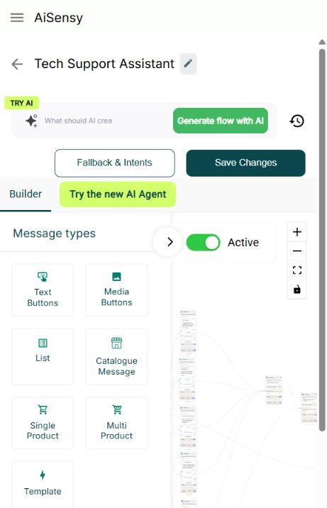
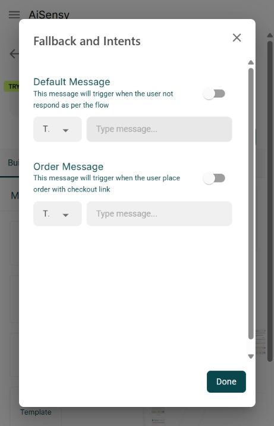
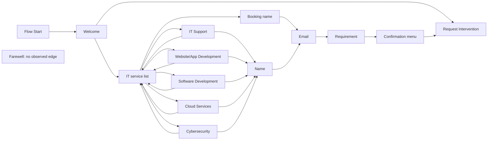

# AiSensy flow builder: full extraction and replication specification

Inspected **29 October 2026**. Target: [Tech Support Assistant builder](https://www.app.aisensy.com/projects/6ad89a5dbc797ae5b62b2c37/flows/flow-page/6ae2e9815abdd78a8415850b).

The extraction contains **294 UI/code capability entries**, **15 separately marked engineering recommendations**, **375 static UI literal occurrences**, **12 explicit option arrays**, **21 palette definitions**, and **one additional icebreaker component**. The current account displays 19 palette entries; WhatsApp Forms and WhatsApp Pay are conditional code paths. Easyinsights is visible but unavailable.

This is a frontend feature and interaction specification, with successful REA static evidence. It does not establish AiSensy's private backend implementation or prove that every integration executes successfully. “Complete” here means the full discovered builder surface and its configuration branches, with remaining unknowns stated explicitly.

## Deliverables

| File | Contents |
| --- | --- |
| [Interactive catalog](catalog.html) | Searchable capabilities, node library, UI literal index, exact option sets, local preview examples, screenshots and evidence limits |
| [Feature checklist](feature-catalog.csv) | 309 individually identified rows: 294 UI/code capabilities plus 15 recommendations |
| [Machine-readable capabilities](feature-catalog.json) | Same catalog, with groups, evidence status and source references |
| [Node library](node-library.json) | All 22 discovered node/content kinds, fields, behavior, availability and source lines |
| [UI element index](ui-elements.json) | All 375 literal occurrences of labels, placeholders, helper text and numeric input constraints found by the selected AST extraction |
| [Option sets](option-sets.json) | Twelve directly declared option arrays; dynamic account-driven options remain dynamic |
| [Observed graph](observed-tech-support-graph.json) | 15 rendered nodes, 24 edges, form values and port identities from the user's exact flow |
| [Evidence manifest](evidence-manifest.json) | Source hashes, REA identity, parsing statistics and coverage limits |

Raw artifacts are in `../../../.reference/aisensy-full-2026-10-29/` relative to this directory. This directory is ignored by Git. It includes the original minified code, a formatted inspection copy, REA JSON, DOM captures, asset references, and screenshots. The screenshots in this report are direct captures. Preview examples in the catalog are clearly labeled local reconstructions; they are not screenshots or a working replica.

Verification: every JSON artifact parsed, the catalog's embedded data parsed, its JavaScript passed syntax parsing, capability IDs/node kinds were unique, and the restored graph counts matched 15/24. Visual/interactivity verification of the local HTML catalog could not run because the browser's localhost-origin permission was declined. No alternate browser/network path was used to bypass that decision.

## Evidence and inspection boundaries

- **UI observed:** authenticated page controls, sample content, created-but-unsaved inspection nodes and rendered DOM. This establishes the editor surface, not delivery success.
- **Static code observed:** declarations and transformations in the shipped builder module `32506`, recovered from `9817.73e2be4d.chunk.js`. The formatted source is `builder-readable.js`; line references in the catalogs point to that derived file.
- **Gated static code:** shipped features hidden or disabled by account configuration. Their presence is verified; availability for this account is not assumed.
- **Recommended:** implementation work needed to build a reliable replica. These entries are explicitly separate from extracted AiSensy behavior.
- **Historical:** the older report `../aisensy-flow-builder-extraction.md` was used only for context. It analyzed another build and included recruitment/management surfaces. Those historical observations are not promoted into fresh findings for this exact editor.

REA 6.7.0's MCP analysis call returned `MCP tool call requires approval, but approval policy is never`. The authorized CLI fallback successfully analyzed the selected current builder chunk, producing evidence `ev_7adb909a73ff652388d0fcade106e4c9fd82ed25d4713152ba61b2d3553f51e3`: 475,317 source bytes, 112,548 AST nodes visited, nine module graph entries, 228 findings, and zero parse failures. The complete record is `rea-builder-evidence.json` in the raw artifact directory.

The graph remains **partial**: 16 inventoried files were outside the selected analysis, and dynamic/ambiguous relationships remain unknown. Semantic retention is truncated by the requested budgets. A broader main-bundle attempt timed out and is retained as `rea-main-evidence.json`; it is not successful full-application evidence. The source was parsed as inert text and never executed locally.

The live page loaded `main.01f91df0.js`, not the earlier `main.6e46243e.js`. The manifest hashes all 17 acquired files, totaling 4,851,111 bytes. No credentials, cookies or storage values were exported. REA passive browser capture was not obtained: no usable browser CDP endpoint was established. Live UI evidence came through the existing authenticated browser tab.

## 1. Workspace and canvas

The screen consists of an application header, flow title/back navigation, AI authoring area, fallback/save controls, Builder/AI Agent tabs, an activation switch, a collapsible palette, a React Flow graph, a minimap and canvas controls. Content is edited inside graph cards. A preview panel can open on the right.

| Surface | Extracted controls and behavior |
| --- | --- |
| Header | Menu, AiSensy name, Back, editable flow name |
| AI authoring | Prompt affordance, Generate flow with AI, Previous prompts; responsive layouts change the presentation |
| Flow controls | Fallback & Intents, Save Changes, Active/Inactive |
| Palette | Message types, Actions, Integrations; two-column icon tiles; independent vertical scrolling; collapse/expand affordance |
| Canvas | Pan/zoom, nodes, branch ports, animated connections, delete-edge ×, dotted background |
| Navigation | Zoom in/out, fit view, interactivity toggle; pannable/zoomable minimap |
| Node toolbar | Duplicate/delete; content preview/edit; add content; move block up/down; remove block |
| Node content | Header derived from content kind, inline editors, counts/validation borders, target input and source outputs |

Static connection creation prevents direct self-connections and a second edge from the same source handle. It permits different output handles to route to different nodes. It does **not** establish global cycle prevention. Existing flow edges demonstrate return-to-menu cycles.

Dropping a palette tile projects the pointer into graph coordinates. Tapping a tile inserts at the current canvas center. Dropping a connection on empty canvas creates a temporary node selector. Clicking the pane dismisses that temporary selector. Canvas configuration uses minimum zoom 0.1 and maximum zoom 1. A `snapGrid` declaration exists, but that alone does not prove snapping is enabled.

Read-only generation mode disables selection, dragging and connecting. Graph restore filters dangling edges and repairs nonfinite/extreme node coordinates. Composite nodes contain an ordered `content[]`, so a replica needs both **node-level** and **content-level** state.

Source areas: formatted lines 13,275–13,690, 14,838–15,490, and 18,230–18,275.

## 2. Entry triggers

| Trigger | Editor configuration | Routing/limits |
| --- | --- | --- |
| Keyword | Type keyword and Enter; removable chips | Default start output; precedence/exact matching semantics remain unknown |
| Regex | Expression and case-sensitivity switch | UI describes substring triggering; backend regex engine/limits unobserved |
| Template | Choose Template, template preview, parameter/media configuration | Base account: one; Pro code path: five. Template quick replies can select different routes |
| Meta Ad | Choose Facebook Ad; search, multi-select, sponsored-ad preview | Up to 20; individual ad output identities |
| QR campaign | Choose QR Campaign, campaign table/preview, active trigger message | Conditional feature; one campaign; hidden in partner contexts |
| Icebreaker | Existing account-provided entries | Per-icebreaker outputs; text is disabled in the discovered component and capped at 80 |
| Order/cart | Conditional order start area | `$cartData`, `$rawData`, `$totalCartValue`; separate order output |

The template picker declares that click-tracking-enabled templates will not appear in its list. It has name/status/type/creation/action columns and search. The Meta ad and QR pickers include their own preview surfaces.

The inspected Tech Support Assistant currently has **no keyword chips or regex value** in its rendered start fields. This does not prove the active flow cannot start through another channel.

Source areas: lines 5,700–7,800; save compiler around 17,460–17,555.

## 3. All discovered node and content kinds

| Name / internal type | Configuration | Outputs and preview | Evidence status |
| --- | --- | --- | --- |
| Text Buttons / `message` | Body, reply buttons, AI keywords, delay, timeout | Button-specific ports; WhatsApp bubble/buttons | UI and code |
| Media Buttons / `imageWithCaption` | IMAGE/VIDEO/AUDIO/FILE; URL/media selection; caption; FILE name; buttons | Media preview; reply ports; AUDIO selection clears buttons | UI and code |
| List / `listMessage` | Header/body/footer; sections; row title/description; CTA; fallback; timeout | Per-row branches; expandable phone list | UI and code |
| Catalogue Message / `catalogueMessage` | Body/footer; AI keywords | Compiled `catalog_message` | UI and code |
| Single Product / `singleProductMessage` | Product picker, body/footer | Thumbnail/title/price; catalogue/retailer IDs | UI and code |
| Multi Product / `multiProductMessage` | Header/body/footer, sections/products, CTA | Product cover/count and sectioned product sheet | UI and code |
| Template / `templateMessage` | Template picker, variables/media, AI keywords | Template-specific renderer and quick replies | UI and code |
| WhatsApp Forms / `whatsappForms` | Flow ID/token, first screen, Draft/Published, header/body/footer, CTA, navigate/data_exchange, custom-data attribute, error message, timeout | Meta Flow message and continuation | Gated code |
| WhatsApp Pay / `whatsappPay` | Account-derived payment mode; template; parameters; currency; product name/quantity/unit amount; timeout | Payment continuation | Gated code |
| Request Intervention / `humanIntervention` | Handoff action card; can appear in composite message node | Compiled human-intervention action | UI and code |
| Meta Conversions API / `ConversionApi` | Lead/Purchase, currency, value | Continuation; Lead fields optional | UI and code |
| Condition / `condition` | Equal/Exists/Time In/Date In; attributes or literal; range | True/False branches | UI and code |
| Connect Flow / `connectFlows` | Existing-flow selector | Destination flow; return semantics unknown | UI and code |
| Ask Address / `questionAddressMessage` | Prompt, raw attribute, formatted attribute, timeout | Address capture continuation | UI and code |
| Ask Location / `questionLocationMessage` | Prompt, longitude attribute, latitude attribute, timeout | Location capture continuation | UI and code |
| Ask Question / `questionMessage` | Prompt, attribute, type/format, regex/min/max, attempts, error message, skip, delay/timeout | Success, validation error and timeout | UI and code |
| Ask Media / `questionMediaMessage` | Prompt, attribute, media type, attempts, error message, skip, delay/timeout | Success, validation error and timeout | UI and code |
| Set Attribute / `setAVariable` | Attribute selector and literal/variable value | State update continuation | UI and code |
| Add Tag / `addTag` | Tag selector, multiple tags, create-tag dialog | Tag action continuation | UI and code |
| API Request / `setupWebhook` | Request builder, test, response mapping, status branches | Fallback and custom-status outputs | UI and code |
| Easyinsights / `easyinsights` | Event, conversion/revenue/currency/discount/offer fields | Integration continuation | UI unavailable; code present |
| Ice Breakers / `iceBreaker` | Existing icebreaker labels | Per-entry routing | Conditional component; not a current palette tile |

The node JSON contains a separate record for every row, including formatted-source references. There are nine message/commerce definitions, 11 action definitions, one integration definition, and the extra icebreaker component. The seven currently visible message definitions omit Forms and Pay.

## 4. Text, media, lists and commerce details

Text supports a body and up to three reply buttons. Each reply has its own stable ID and output handle. The body shows a 1024-character counter and the button title a 20-character counter. AI keywords are attached to message content independently of the Flow Start keywords.

Media supports IMAGE, VIDEO, AUDIO and FILE. It accepts a URL or a media-picker interaction; FILE adds a filename field with a 100-character constraint. The caption uses a 1024-character constraint. Choosing AUDIO clears the button configuration in the frontend. This is frontend behavior, not proof of all WhatsApp delivery combinations.

List configuration includes header, body, footer, section title, item title, item description, CTA, fallback message and timeout. Rows and sections can be added/removed. Each row has a distinct output. The add-row guard counts ten rows across sections; the add-section guard checks ten sections separately. A complete replica should validate the final payload independently of these UI checks.

Single-product configuration chooses a catalogue product and carries its `catalogueId` and `retailerId`. Multi-product configuration organizes chosen products into titled sections and displays a product count. The code checks 30 **sections** in one add-section guard; this must not be copied as a verified Meta transport limit. Catalogue Message is a separate `catalog_message` payload, not the same as a multi-product list.

Template content uses a reusable template-renderer/configurator. Required variable values and media are part of template configuration. Template rendering also appears in entry-trigger selection and payment-related surfaces.

## 5. Questions, validation, retries and state

Ask Question offers **Any, Text, Number, Date, True/False, Email and Regex**. Number exposes minimum/maximum inputs. Regex exposes an expression. Validation-specific configuration includes number of attempts, error message, an error output, and a skippable option/skip text in applicable paths. The serialized default attempt count is one. The Date help describes DD-MM-YYYY and YYYY-MM-DD; actual backend parsing was not exercised.

Ask Media exposes Image, Video, Document and Audio as explicit options. Its created/default state and compiler can also contain `Any`, even though `Any` is not in that explicit options array. Keep this discrepancy in the compatibility checklist.

Address capture writes to separate raw and formatted attributes. Location capture writes to longitude and latitude attributes. The exact incoming address object, media metadata, retention policy and invalid-location behavior are not available from this inspection.

Attribute assignment exposes an attribute and value. Message examples reference `$ref_number`; the code and API body example also use `$attribute` syntax. Attribute pickers and global-attribute pickers exist in API configuration. These facts do not establish whether an attribute is conversation-scoped, contact-scoped or workspace-scoped; define that explicitly in the replica.

Tag creation has Tag Name, Category and Customer Journey tracking. The form can use an existing category or a new one. No tag was submitted during this inspection.

## 6. Conditions and flow connections

- **Equal:** attribute compared with typed literal or another `$attribute`.
- **Exists:** attribute selection without a comparison value.
- **Time In:** start/end time, compared with Now or an attribute; UTC and hh:mm hints.
- **Date In:** start/end date, compared with Now or an attribute; UTC hint. The date picker displays `dd/MM/yyyy` while comparison help says `mm-dd-yyyy`; preserve this as an ambiguity to resolve, not as a valid universal format rule.

Each condition exposes True and False source ports. There is no evidence here of AND/OR groups, arbitrary JavaScript conditions, greater-than/less-than operators, or custom scripts in the condition editor. Do not silently add those to an “extracted” parity list.

Connect Flow selects an existing flow. The compiler includes the destination identity, but the frontend does not settle call/return semantics, active-run ownership, cycle limits or what happens when the destination is disabled/deleted.

## 7. Delay and timeout

Delay is a numeric seconds input; timeout is a separate enable toggle and numeric minutes input with an **After Timeout** source port. Both are gated by account/feature configuration and may show PRO upgrade affordances.

The default timeout input code uses min 1, max 1000 and integer step 1, while its default helper reads “1 to 72.” This conflict is verified in the frontend. It does not prove what the backend accepts. Do not hard-code either maximum as a universal runtime fact without a contract test.

Timeout configuration compiles into a timeout duration and timeout target. Timer durability, restart behavior, cancellation on response and race handling were not observed.

## 8. API Request, fully broken down

The node opens a request configuration surface and summarizes its URL, JSON data and response-capture attributes. It has a **Status Fallback** continuation and up to **five custom HTTP-status branches**.

| Area | Extracted fields and controls |
| --- | --- |
| Request line | GET, POST, PUT, PATCH, DELETE; URL |
| Params | Add/remove key-value rows |
| Headers | Add/remove key-value rows |
| Values | Literal values or Attributes / Global Attributes picker |
| Body | Editable JSON code pane; JSON parsing and invalid-JSON alert |
| Test | Loading state, Test action, response/status display |
| Save | Disabled until `isTestPass` becomes true; edits reset test state |
| Response | Formatted response JSON; status coloring |
| Mapping | Target attribute plus nested dot-path response key; multiple mappings |
| Routing | Status Fallback; custom code field and dedicated handle per code |
| Quota | Remaining = configured extra `apiRequestCount` + 5 − current API content blocks |

The `5/5` badge therefore has a concrete frontend interpretation: base five API node slots with optional extra allowance, reduced by existing API content. It is not evidence of five HTTP requests per second/day.

The test UI posts to `/testing/webhook-test` with URL, method, params, headers, data and assistant identity. **No test was sent.** The request's catch branch also sets `isTestPass: true`, so the Save gate means a test attempt has occurred; it does not reliably prove a successful remote response. This is a useful parity warning rather than behavior to imitate.

Unknowns include production executor timeouts, retries, allowed destinations, response-size limits, redirect handling, secret storage, authorization, and which status branch wins. The replica needs its own explicit server-side policy and tests.

## 9. Conversion, Forms, payment and Easyinsights capabilities

**Meta Conversions API:** Lead and Purchase. Lead marks amount/currency optional. Purchase frontend validation requires currency and a numeric nonzero value. The currency default compiles as INR. Successful event delivery, deduplication and attribution identity are unobserved.

**Easyinsights:** New Lead, Status Change and Transaction. Status Change uses a conversion name. Transaction uses revenue, currency, discount and offer code. The palette routes unavailable installations toward integration setup and can hide the integration in partner contexts. The inspected account says it is not live.

**WhatsApp Forms:** gated tile; Meta Flow ID, token, first screen, Draft/Published, header/body/footer, CTA, navigate or data_exchange action, optional custom-data attribute, validation error, continuation and timeout. Compiler uses `flow_message_version: "3"`. The builder sends an external Meta Flow; this does not establish a full Meta Flow form designer inside this screen.

**WhatsApp Pay:** hidden without payment configuration. Choices derive from account configuration: WhatsApp UPI, Payment Link, All method; EPL appears under a separate condition. It has payment template selection, approved-EPL-template filtering, parameters, INR/USD choices, custom product toggle, product name, quantity, per-unit amount, continuation and timeout. Gateway completion, settlement and refund behavior are outside the evidence.

## 10. UI elements and preview anatomy

The machine-readable UI extraction enumerates repeated occurrences, not 375 unique components. It includes literal labels, placeholders, helper text, `maxLength`, numeric min/max/step declarations and accessibility labels. Dynamic values such as actual tag names, products, flows, attributes and template names remain account-driven.

The preview implementation contains:

1. A 355px right-side panel with a mobile WhatsApp-style frame.
2. Sticky header with business avatar/fallback avatar, WhatsApp number, back/close controls.
3. Chat wallpaper, message bubble/tail, header/body/footer, asterisk-to-bold formatting.
4. Reply button representations.
5. Media image representation; this does not prove every AUDIO/VIDEO/FILE preview is simulated accurately.
6. Single-product thumbnail, name and price.
7. Multi-product cover, item count and CTA.
8. Expandable list sheet with section headings and item title/description.
9. Expandable product sheet with image/title/description/price and add affordance.
10. Template preview renderer and Facebook-sponsored-ad previews.

The code also provides “Preview with edit” actions in relevant configuration surfaces. These are **graphical previews**, not a verified end-to-end conversation simulator. The catalog's offline preview gallery demonstrates the discovered element anatomy with labeled local mockups and safe local interactions.

Core design values recovered in the formatted source include green `#008069`, dark teal `#0A474C`, pale gray `#E9EDEF`, purple-tinted content background `#edeef9`, white cards, Inter typography, 214px composite cards, a 240px palette, and the 355px preview panel. Responsive wrappers and browser scaling affect rendered dimensions; these are source values, not a pixel-perfect reconstruction claim.

The observed asset inventory contains 206 references at the initial state: 64 scripts, 49 images, six stylesheets, two fonts, two videos and 83 other references, plus 158 inline SVG occurrences. Many belong to the surrounding app/third-party widgets, not just the builder. The asset bundle download was declined by the browser gate; asset URLs and existing SVG markup are retained in the inventory, but font/image/stylesheet file extraction is **not complete**. No workaround was attempted.





## 11. Fallback, AI authoring and history

Fallback & Intents contains independent Default Message and Order Message settings. Each has an enable toggle and TEXT/IMAGE/VIDEO variant. The UI describes Default as handling replies that do not follow the flow and Order as handling an order with a checkout link. The dialog has Done and Close actions. No additional independently configurable intent classifier was established merely from this dialog's title.

AI authoring includes a 1000-character prompt, example prompts, generation/loading state, streamed node/edge insertion, duplicate suppression and temporary read-only editing. Previous prompts supports Copy, Restore, search/empty states, Today/This Week/This Month/Custom Range filters and replacement decisions. Replacement can Save & Replace or Discard & Replace. Navigation also has Save/Discard unsaved-flow handling.

The separate “Try the new AI Agent” tab is an adjacent product surface. Its website knowledge ingestion, model/provider, tool execution and agent behavior are not established as capabilities of this builder by the tab's presence. No prompt generation was started.

## 12. The exact Tech Support Assistant flow

Observed graph: 15 nodes and 24 edge occurrences. It includes a welcome menu, six-item services list, five service-detail messages, a booking-name question, a general-name question, email and requirement questions, a confirmation menu, intervention, and an unconnected farewell message.



The diagram preserves the 24 observed source-target edges. Button/list-row labels are intentionally not assigned to those edges: rendered edge accessibility labels identify source and target, but do not reliably pair a particular output handle to a particular path. The graph JSON preserves the independently observed ports.

Several answer-capture attribute selectors are empty in the current sample, and its confirmation mentions `$ref_number` without a verified reference-number-generation action. There is no API Request node in this saved sample. Authored text saying a request was submitted does not establish a ticket database or actual backend submission.

## 13. Replication contracts

For every discovered node, parity requires **configuration editor + validation + preview + persisted schema + executable behavior + failure/timeout path + diagnostics**. The frontend node set alone is insufficient.

Suggested model (a new design, not a recovered server schema):

```text
FlowDraft: id, name, triggerDefinitions, fallbackDefinitions, nodes, edges
Node: id, position, content[]
Content: id, kind, typedConfig, optionalDelay, optionalTimeout
Edge: sourceNodeId, sourceHandleId, targetNodeId, targetHandleId
PublishedVersion: immutable validated graph and referenced dependencies
Run: contact, version, currentNode/content, attributes, awaitingReply, state
Step: visit identity, selected branch, effect identity, attempt, timestamps
Timer: run/step identity, deadline, timeout target, cancellation state
```

Recommended subsystem boundaries:

| Subsystem | Needed behavior |
| --- | --- |
| Editor | Composite content cards, stable IDs, all branch ports, undoable edits, schema validation, preview library |
| Trigger router | Keyword/regex/template/ad/QR/order/icebreaker normalization and deterministic priority |
| Conversation runner | Sequential content, reply waiting, typed capture, invalid-answer retries, branching, cross-flow transitions |
| State | Explicit run/contact/global attribute scopes, tags, permission boundaries |
| Scheduler | Durable delay/timeout, cancellation and reply-vs-timer race resolution |
| Delivery | WhatsApp payload compilation, reply context binding, media/template/catalogue support, idempotency |
| Integrations | Safe HTTP executor, response mapping, conversion events, Easyinsights, Forms and payment adapters |
| Release/testing | Separate drafts and immutable published versions, simulator, optional scoped live testing, run trace/history |

These are recommendations. In particular, undo/redo, immutable publication, a simulator and diagnostic logs are not claimed as newly verified AiSensy editor features.

Acceptance scenarios should cover all 22 discovered kinds, missing required fields, boundary lengths, invalid answer retries, exhausted attempts, skip, default fallback, timeout, reply after timeout, disabled integration, API network/status failures, stale reply IDs, duplicate webhook delivery, looping menus, connect-flow cycles, and restoration of old saved graphs. Real delivery requires separately authorized recipients and configured integrations.

## 14. Remaining gaps and next evidence needed

| Unknown | Evidence needed to close it |
| --- | --- |
| Private runtime behavior and schemas | Authorized API/network capture or controlled sandbox execution |
| Trigger conflicts/priority | Two matching test flows and controlled inbound events |
| Exact branch-to-edge mapping in current sample | Serialized graph or edge handle metadata tied to the paths |
| Attribute scope and persistence | Controlled set/read across runs and contacts |
| Delay/timeout limits and races | Controlled time-based tests and server validation responses |
| Retry, skip and date semantics | Invalid/valid typed answers in a sandbox |
| Handoff assignment/resume | Controlled agent intervention test |
| Cross-flow call/return behavior | Controlled pair of flows |
| Commerce picker contents and checkout behavior | Connected test catalogue and order events |
| Forms, payment and live Easyinsights | Feature-enabled test account/integrations |
| API executor policies and secret handling | Authorized configuration/contract or controlled endpoint tests |
| Media formats/upload limits and full preview fidelity | Media-picker inspection and controlled files |
| AI generation accuracy/provider and history execution | Controlled draft generation and restore |
| Full image/font/style asset package | User-approved asset download through the browser gate |

The original flow was restored and verified at 15 nodes/24 edges. Temporary inspection nodes were discarded by reload. No Save Changes, activation change, tag creation, API Test, AI generation, handoff, payment or outbound message was executed. Existing unrelated workspace changes were left in place. This task creates research artifacts, not application implementation or deployment.
