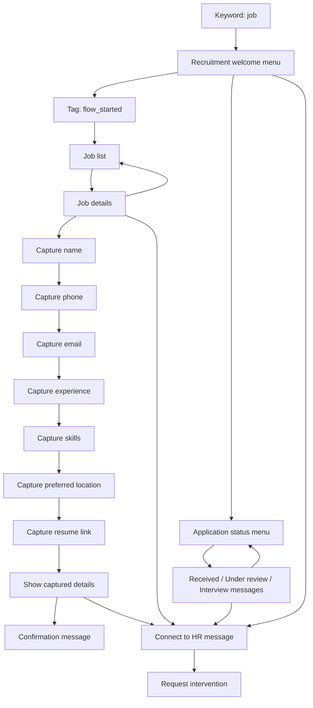

# AiSensy flow builder: feature extraction for BODHINOX

Inspected: 24 October 2026. Scope: authenticated, read-only browser inspection, a REA static-analysis attempt against the shipped public JavaScript bundle, and comparison with the existing BODHINOX flow implementation. No flows were saved, activated, duplicated, deleted, or executed; no messages were sent and no purchases were made.

Source: https://www.app.aisensy.com/projects/6ad89a5dbc797ae5b62b2c37/flows/flow-builder

## Evidence and confidence

**Observed UI** means controls, values, and rendered graph elements were inspected in the authenticated browser. It does not prove that the corresponding server-side action works. **BODHINOX source** means the current local implementation was inspected, not tested during this research task. **Proposed** means an implementation requirement derived from the comparison.

Local supporting evidence is under the ignored `.reference/aisensy-rea/` directory:

- `editor-dom.txt`, `fallback-dom.txt`, `question-formats-dom.txt`: recruitment editor and configuration controls.
- `flow-inventory-dom.txt`, `templates-dom.txt`, `test-numbers-dom.txt`: flow management, gallery, and testing controls; recipient values redacted in the testing snapshot.
- `global-attributes-dom.txt`, `support-editor-dom.txt`, `ai-onboarding-dom.txt`: related features.
- `recruitment-rendered-graph.json`: 20 DOM-rendered nodes, 29 edge occurrences, input values, and port identifiers.
- `api-template-preview-dom.txt`: failed preview observation.
- `rea-evidence.json`, `rea-evidence-expanded.json`: REA results, including explicit failures and partial evidence.

The readable graph export beside this report is an observation format, **not an AiSensy API export and not an executable BODHINOX flow**. In particular, the browser edge labels establish source and target nodes but do not reliably establish which button/list item owns each edge. Repeated edges must be preserved until that mapping is resolved.

## Extracted product behavior

### Flow management and testing

- Search flows by name; view creator, status, and duplicate/edit/delete controls.
- Create a flow, use an industry template, or open an existing flow.
- Separate Your Flows, Templates, and Test Numbers tabs.
- Account inspected: three flows, two enabled with **Testing only** labels. The UI states that live access requires the applicable paid addon; these are account-specific limits.
- Test Numbers accepts up to three WhatsApp numbers. Its explanation says both published and unpublished flows can run for those numbers. This was **not executed**.
- Gallery displayed 72 templates with category filters, search, preview, live demo, and use-template controls. Only the first page and one preview were inspected; no template was applied.

### Graph authoring

- React Flow canvas with a node palette, connected ports, edge removal controls, minimap, zoom, fit-view, and interactivity controls.
- Nodes expose editable content directly on the canvas, rather than requiring a separate configuration sheet.
- Palette groups Message types, Actions, and Integrations.
- Flow name, Builder tab, activation toggle, Save Changes, Fallback & Intents, Generate flow with AI, and Previous prompts are present.
- Buttons/list choices branch to different nodes; question nodes suspend progression until a response is collected. The stored graph was inspected, not run.
- Some nodes offer multiple content blocks through Add Content, plus delay and timeout controls marked PRO. Their timing, ordering, and billing behavior remain untested.

### Entry triggers

The Flow Start block exposes:

- Keywords entered as chips; recruitment flow uses `job`.
- A regex field and case-sensitive regex toggle.
- Up to one template selection to begin a flow.
- Up to 20 Meta ad selections to begin a flow.

The incoming webhook mapping, trigger precedence, and behavior when several flows match were not observed.

### Node library

| Category | Palette item | Inspection depth |
| --- | --- | --- |
| Messaging | Text Buttons | Existing nodes, text/buttons, counters and branching inspected |
| Messaging | Media Buttons | Palette presence; detailed media configuration not inspected |
| Messaging | List | Existing header/body/footer, section, rows, descriptions, and branch structure inspected |
| Commerce | Catalogue Message, Single Product, Multi Product | Palette presence only; no catalogue connected |
| Messaging | Template | Palette presence and entry-template picker observed; send behavior untested |
| Routing | Request Intervention | Existing terminal handoff node observed; no live handoff executed |
| Logic | Condition | Palette presence only; exact operand vocabulary not inspected |
| Routing | Connect Flow | Palette presence only; transfer/resume semantics unknown |
| Input | Ask Question | Existing nodes, captured attribute, and format options inspected |
| Input | Ask Address, Ask Location, Ask Media | Palette presence only; response shapes unknown |
| State | Set Attribute | Palette presence; global-attribute management inspected separately |
| State | Add Tag | Existing `flow_started` tag node observed |
| Integration | API Request | Palette shows `5/5`; method, headers, response mapping, and quota semantics unverified |
| Integration | Meta Conversions API, Easyinsights | Palette presence; Easyinsights indicated not live |

Question formats offered: Any, Text, Number, Date, True/False, Email, and Regex. Date help names DD-MM-YYYY and YYYY-MM-DD. Captured values can be referenced in message content as `$candidate_name`, `$candidate_email`, etc. Actual conversion/validation behavior was not exercised.

### Fallback and AI

- Fallback & Intents contains an enabled/disabled Default Message described as handling replies that do not follow the flow.
- Separate Order Message described as triggering after an order with a checkout link.
- Default-message type selector offers TEXT, IMAGE, and VIDEO.
- Existing message nodes expose AI keyword fields; their classification/dispatch behavior remains unknown.
- Separate AI Agent onboarding asks for website URL, business type, special instructions, business context, agent name, and greeting. It says it will crawl the website to build knowledge. No crawl or agent creation was started.
- AI generation controls alone do not prove that AI owns a running flow or that a particular model/provider is used.

## Recruitment flow outline

The rendered graph contains 20 nodes and 29 edge occurrences. Human-readable summary:

This diagram consolidates status nodes and duplicate edges for readability; use the JSON for the full observed node topology. Branch names are inferred from nearby message content, not verified button-to-port routing.

The template is not a complete recruitment backend: visible status messages are authored text; no actual application database or status lookup was verified. Resume collection in this flow asks for a link, rather than demonstrating a file upload.

## BODHINOX comparison

| Capability | Current BODHINOX source | Required delta |
| --- | --- | --- |
| Graph canvas, minimap, draggable positions, port connections | `src/components/flows/flow-canvas.tsx`; shared Canvas/List editor state | Reuse; optionally add the always-visible grouped palette and inline content previews |
| Text, buttons, lists, standalone media | Existing node types and Meta sending helpers | Add combined media-header/buttons only if desired; avoid changing existing node schemas blindly |
| Questions and validation | `collect_input`; runtime Any/Email/Phone/Regex validation | Add Number/Date/Boolean formats and clear retry/error UX if parity is required |
| Conditions | Variables/tags/contact fields with equals/contains/present/absent | Preserve existing operators; AiSensy's exact operators remain unverified |
| Tags and human handoff | `set_tag`, `handoff`, assignment and run events | Reuse existing behavior and AI ownership safeguards |
| Variables | Run variables and `{{vars.X}}` interpolation | Retain syntax; add attribute picker/preview rather than copying `$name` syntax unnecessarily |
| Unexpected reply handling | Reprompt/handoff/ignore/AI policies, retry cap and stale-run cutoff | Surface clearly in editor and simulator; optional media fallback is an extension |
| Templates | Existing starter-template system | Extend catalogue with original, validated templates and read-only preview |
| Triggers | Keyword, first inbound, manual | Template/ad triggers and regex entry matching require new contracts and webhook tests |
| Flow-to-flow connection | No `connect_flow` in current node-type union | Add bounded transition semantics, cycle protection and cross-flow traceability |
| Address/location/inbound media capture | Not in current flow input-node union | Extend webhook normalization, persistence, validation and runtime together |
| API requests | No API-request flow node in current union | Add a server-side request executor, timeout/retry policy, response mapping, secret references and network destination safeguards |
| Catalogue/product nodes and conversion events | Not in current flow node union | Separate Meta integration work; palette controls alone are insufficient |
| Shared attributes | No equivalent flow-level global-attribute facility established by this comparison | Distinguish run variables, contact fields and workspace secrets; avoid exposing secrets in previews/logs |
| Test-number allowlist | No equivalent draft-flow test-number mode established | Add isolated simulation first; opt-in real WhatsApp testing with explicit target and published/draft rules |
| AI generation / website knowledge ingestion | AI providers/knowledge system already exist elsewhere in BODHINOX | Reuse that infrastructure; generation must produce validated draft graphs, without auto-publishing |

This is a source-level comparison of flow-specific code, not a claim that similarly named functionality is absent everywhere else in the application.

## Recommended implementation sequence

1. **Editor and preview:** grouped node palette, clear trigger/fallback panels, realistic message previews, variable/attribute picker, and safe template preview. Keep existing Canvas/List state and runtime.
2. **Test before live:** local simulation using the same graph validation and transition logic; expose current node, captured values, chosen branch and fallback reason. Gate external effects. Then add an explicitly scoped WhatsApp test-number mode.
3. **Core extensions:** flow connection, additional question formats, contact-attribute actions, and inbound media/location capture. Define versioned node configs and update schema validation, editor, engine, webhook parsing and logs together.
4. **Integrations:** API-request nodes and template/ad triggers; separately implement catalogue/products and Meta conversion events where required.
5. **AI authoring:** generate original draft graphs from a business prompt using existing providers; validate, preview and require an explicit publish action. Keep flow ownership and AI fallback explicit so off-topic replies do not silently advance a flow.

Acceptance tests should cover branch identity, duplicate webhook delivery, invalid answers, unknown replies, timeout, handoff ownership, the 24-hour service window, safe cyclic-flow limits, draft/live separation, API failure/secret handling, and backward compatibility with saved flows. Existing flows must continue to load and run without migration-by-opening.

## REA result and limits

Observed shipped bundle: `https://www.app.aisensy.com/static/js/main.6e46243e.js` (3,436,334 bytes), SHA-256 `d58dc2896d4ac06cda11e89f594ad0910880b784f6f4ba3f6954d4e6236ff330`.

REA 6.7.0 was invoked through its CLI because its MCP tools are not exposed in this active session. The first static-analysis attempt exhausted its default worker heap and returned partial evidence `ev_6b3030706f87a70b92767b91ae88bdf61821943130235535750f469057b26ff2`. A bounded retry with a 4 GB heap timed out after 120 seconds and retained partial evidence `ev_ef42751bb4d8f2682aae2284005932af987c85629a4370f81f3f2a9c908dc514`.

Consequently, this report does **not** claim recovered source code, complete handler/API mappings, backend implementation, or REA-verified runtime execution. REA analyzed inert public artifact bytes; authenticated UI observations were captured separately through the browser tools. No credentials, cookies or tokens were exported into the analysis input.

Other limits: the Recruitment/Job Bot API template preview produced `Cannot read properties of undefined (reading 'params')`. Its API node internals were not accessible through that preview. Existing recruitment inputs also show counters exceeding their displayed limits (for example 24/20 for a button label); this establishes an authoring warning, not whether a live send would be rejected. BODHINOX should enforce valid WhatsApp payload limits rather than copying those invalid example values.

## Deliverable boundary

This task produced a feature specification, observed graph export, and local evidence. It did not implement or deploy these extensions to BODHINOX. AiSensy settings and flows were left unchanged.
