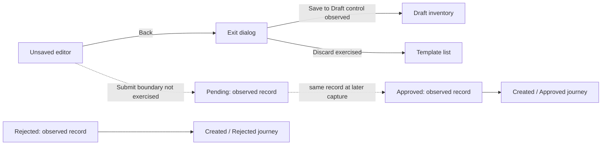

# AiSensy Template Messages: replication research

Research captured 30 October 2026 from the authenticated Template Messages and New Template Message screens. **Documentation only: no application implementation, template submission, draft save, deletion, purchase, or message send was performed.** Temporary form edits were discarded through the app's discard dialog.

Start with [the searchable catalog](catalog.html). It includes **133 capability records, all 31 visible library templates, screenshots, and evidence links**. The raw UI inventory contains **4,871 element occurrences across 38 snapshots**, including repeated elements and helper text; these are not 4,871 distinct features. The creation dropdown exposed **68 languages**.

## Contents and evidence standard

- [Feature JSON](feature-catalog.json) and [CSV](feature-catalog.csv): IDs, area, behavior, observation class, evidence path.
- [UI elements](ui-elements.json): every captured accessibility/DOM snapshot element with its source line.
- [Library](template-library.json): name, type, badge, full displayed example body, source for all 31 cards.
- [Language options](languages.json) and [authentication localization keys](authentication-languages.json).
- [Static findings](static-findings.md): source lines, store behavior, rendering contracts and missing chunks.
- [REA evidence](rea-static-evidence.json), [source manifest](static-source-manifest.json), and [artifact hashes](evidence-manifest.json).
- [Evidence directory](evidence/): rendered snapshots and PNG captures.

**Observed UI** means the field/state was displayed or a local interaction was exercised. A visible button is not proof its backend operation works. **Static source** means an inert inspection of previously retained JavaScript; it is not a current network trace. **Unknown** means evidence is insufficient. Counts describe this account and capture, not a universal product limit.

Target routes: `/projects/{projectId}/manage/template-message` and `/projects/{projectId}/manage/template-message/create`. Project identifier is omitted here because it is not needed to describe the product.

## Screen and component inventory

The management screen has an app header/hamburger, page title, AI Assistant, Create Template, Campaign Agent banner, quick-guide panel and four guide links. A discovery panel offers AI Templates, WhatsApp Status Ads, Lead Form Ads and AI Agent shortcuts. These shortcuts are visible navigation opportunities, not independently audited modules in this report.

The primary working area contains search, Sync, Explore/All/Draft/Pending/Approved/Action Required tabs, origin segmentation (User Generated versus Campaign Agent Generated), pagination and either library cards or the owned-template table. The owned table exposes Name, Category, Status, Type, Health, Created At and Action. Duplicate/Delete controls are per record. High and Unknown health values were seen; quality calculation and recovery rules are unknown.

Clicking an owned name opens a modal with current status, Template Journey, dated events and a WhatsApp-style message preview. Empty drafts show “No templates yet !”, 0–0 of 0, and disabled previous/next buttons. The modal has a close action. [Inventory evidence](evidence/owned-templates.txt), [empty state](evidence/drafts.txt).

The creation screen has Back, New Template Message, account WCC balance, category and language selectors, optional paid TTL, name, type, type-dependent content, sample values, preview, interactive actions and Submit. Marketing adds an AI composition panel. Its layout and overflow are captured in the screenshots; exact font/color/spacing tokens were not extracted, so screenshots are visual references rather than a measured design system.

## Library: complete visible card inventory

Three pages contained 12, 12 and 7 records. Each card exposes a name, message type, optional badge, example copy, Preview and Submit. The data export preserves the displayed copy, including square-bracket sample substitutions. Library card labels FILE and creation label DOCUMENT should be normalized deliberately in a replica.

| Type | Visible templates |
|---|---|
| IMAGE | Dussehra Wishlist; Dussehra Surprise; Final Call; Festive Picks; Shubh Aarambh Sale; Dussehra Offer; SPECIAL SALE OFFER; Final Festive Offer; Bappa Is Here; Modak-Sweet Deal; Shubh Aarambh Offer; Wishes & Offer; Last-Chance Offer; Janmashtami Offer; Rakhi Reminder; Rakhi Collection; Holi Wishes & Offer; Holi Wishes + Offer; First Message; Offer Message; Event Invite; Property Promotion; C.O.D to Prepaid |
| TEXT | Rakhi Promotion; Rakhi Special Offer; Birthday Promotion; Loyalty Program; Webinar Upsell; Cross Sell Message |
| VIDEO | Limited Time Sale |
| FILE | Bank Loan Approved |

Refine by exposes Trending, General, Top Rated and industry categories: Ecommerce, Education, Banking, Webinar, Healthcare, Automobile, Real Estate, Services, Nonprofit. MORE reveals additional industries. Every filter-result combination was not enumerated, so this is the complete captured default library rather than a claim that no hidden/remote library entries exist.

Webinar Upsell's modal displays positional variables, Yes/No replies and Review and Submit. The final action was not pressed. [Preview evidence](evidence/library-quickreply-preview.txt).

## Creation fields and rules

| Component | Observed contract |
|---|---|
| Category | UTILITY, MARKETING, AUTHENTICATION |
| Language | 68 selectable options; exact spellings in languages.json |
| Name | Lowercase alphanumeric and underscores; helper disallows whitespace and special characters; maximum and uniqueness unverified |
| Text header | Optional, up to 60 characters in TEXT mode |
| Main body | Up to 1024 characters; live counter; formatting helper for bold/italic/strikethrough |
| Variables | {{1}}, {{2}}, etc.; detected placeholders produce individual sample-value inputs |
| Samples | Helper says values can change when sending; submission-side sample validation untested |
| Footer | Optional, up to 60 characters where present |
| Preview | Updates during editing, renders formatted body and action rows, carries delivery-difference disclaimer |
| TTL | Describes maximum offline delivery retry window; Premium gate opens plan dialog on this account |
| Submission | Submit exposed; approval request payload and success/error behavior unverified |

Marketing AI contains prompt/counter up to 1024 characters, Previous prompts, Normal/Poetic/Exciting/Funny styles, Click Rate/Reply Rate optimization and a Generate button with a remaining free-generation count. No generation was run. Its output adoption/revision behavior and post-quota pricing remain unknown.

## Message format matrix

| Format | Inspected UI | Boundary |
|---|---|---|
| TEXT | Optional header, formatted body, samples, footer, interactive actions | Server constraints beyond helpers unknown |
| IMAGE | Selected form with retained body and actions | No initial upload field observed; later media workflow unknown |
| VIDEO | Selected form captured | Media limits and upload sample requirements unknown |
| DOCUMENT | Selected form captured | MIME, file-size and retention constraints unknown |
| LOCATION | Selected form captured | Location selection and send-time data entry not exercised |
| CAROUSEL | Shared body, IMAGE/VIDEO selector, active card body, Add Card and preview controls | UI says Marketing only; maximum cards and full validation not tested |
| LIMITED TIME OFFER | IMAGE/VIDEO header, 16-character offer text, Offer Expires, code/action preview | Runtime expiry payload and mandatory fields unknown |

The Utility dropdown still displayed all seven type options. This does **not** establish that all combinations pass server validation. Switching type from TEXT to IMAGE cleared the unsaved action list but retained the main body; type-change reset behavior matters when designing editor state.

Carousel card bodies allow 160 characters. The helper requires either all card bodies empty or none empty. Adding a second card changes the active editor to Card 2. Standard action-mode radios are disabled with All selected; displayed add-button counters are 2 for quick replies, URL and phone, while copy code is disabled. Do not sum these counters into an assumed six-button allowance: aggregate constraints were not tested.

Limited-time offer preview initially exposed an incomplete `Code: undefined` state. Following header and expiry changes it showed SAMPLE and a copy-code field. Those two actions were not isolated, so the precise default-setting trigger is not established. Preserve intended capability, not the transient incomplete-state defect.

## Interactive actions and previews

Standard modes are None, Call to Actions, Quick Replies and All. All was selected initially. A standard empty action list shows counters Quick Replies 10, URL 2, Phone Number 1, Copy Code 1. These are **remaining capacities, not independent totals**: adding one reply, URL, phone and code reduced the reply counter to 6.

- Quick reply: title input, 25-character counter, remove button.
- URL: type, title, URL value, remove action. Pro click tracking is exposed but disabled in this account.
- Phone: type, title, country selector, number/value, remove action; add button disables at zero remaining.
- Copy code: coupon input, 15-character counter, remove action and copy preview; one available in standard Marketing state. UI tooltip restricts it to Marketing/Authentication.
- Added actions reorder by kind in the observed editor: code precedes URL/phone, and CTA precedes quick reply. Arbitrary manual ordering was not established.

Static shared preview code additionally supports personalized URLs, telephone links, clipboard copying, media/file/location placeholders, per-card carousel content and offer-expiry labels. It includes commerce, flow and contact-request action types beyond the seven creation choices. These are **shared renderer capabilities**, not evidence that this template creation screen offers those additional formats.

## Authentication templates

Selecting Authentication changes free-form content into `{{1}} is your verification code.` with a sample-value field. Optional Expiration Warning accepts a numeric value with a 1–90 minute helper. Add Security Disclaimer changes the preview. Copy code is rendered; other action additions are disabled in the inspected state.

The retained source contains language-specific verification text, expiry text, security text and copy-code labels. UI dropdown languages and localization-table keys are stored separately. One-tap/zero-tap OTP, Android package/signature configuration, supported-language/category intersections and final authentication payload are not established.

## Draft and approval journey

The creation **Back** action after edits opens Discard Template. It offers Close, Discard template and Save to Draft. This proves a separate draft-saving entry point; draft persistence was not executed. The test form was discarded and the existing Draft tab was empty.

The library offers Preview → Review and Submit, while the blank creator offers Submit. Their final submission contracts are unknown because no test template was sent for approval.

The observed lifecycle is:

The earlier snapshots showed `welcome` and `cart_drop_without_incentive_b003p` as Pending. The refreshed Approved tab shows both approved. `welcome` displays Created **Thu, Oct 29, 2026, 12:27 PM** and Approved **Fri, Oct 30, 2026, 11:27 AM**. These are displayed timestamps; timezone and exact processing duration should not be inferred. This state refresh is not proof that approval happened during this inspection.

Five older records were rejected: cart_drop_without_incentive, cart_drop_with_incentive_sku, cart_drop_with_incentive, order_information, sample_template_message. The inspected rejection modal shows Created/Rejected journey events without an observed rejection reason or appeal control. Action Required contains these records. Approval is therefore a real visible state transition, but decision criteria, SLAs, category changes, appeals and resubmission remain unknown.

Static code corroborates an important downstream boundary: the approved collection includes only `status === APPROVED`; the all-status collection preserves every returned record. The observed fetching candidate is POST `/api/templates` with `assistantId`. This is a source-derived contract, not a recorded live request. Do not invent creation, sync, deletion or approval endpoints from it.

## Replica specification and open work

For a future implementation, the evidence supports separate library, inventory, editor, preview, journey and entitlement components. A candidate domain model needs identity/project, name, category, language, format, header/body/footer, variable samples, ordered buttons, carousel cards, offer metadata, authentication options, status/health and journey events. This is an analyst recommendation, not an extracted server schema. Keep editable draft state separate from approved sendable templates, and derive remaining-button counters from combined constraints once verified.

Before claiming production parity, resolve:

1. Create/save draft/edit/delete/sync requests, payloads, errors, permissions and concurrency behavior.
2. Submission confirmation, media/sample uploads, mandatory fields and server validation.
3. Meta review rules, rejection reasons, appeal/edit/resubmit and category reclassification.
4. Carousel min/max count, per-card button consistency, variable ordering and URL personalization limits.
5. Paid TTL options/ranges/defaults and successful click-tracking configuration.
6. AI generation results, history, reuse and quota exhaustion.
7. Delivery behavior, webhook/status notifications, actual rendered WhatsApp messages and template quality lifecycle.
8. Responsive layouts, measured design tokens, keyboard navigation and accessibility behavior beyond captured semantics.

## Method and verification

REA CLI 6.7.0 parsed two analyst-extracted modules from the previously retained main bundle without executing them: 37,719 bytes, 1,661 AST nodes, zero parse failures, partial graph coverage. The full evidence ID and limits are in static-findings.md. Missing lazy chunks prevent full creation-handler reconstruction. Live UI inspection supplied the editor/list/journey evidence; no new private assets were downloaded.

The report generator validates JSON files, capability evidence paths, exactly 31 library records and catalog inline JavaScript syntax. The offline catalog has not undergone an interactive browser rendering test. PNGs and source files are included with SHA-256 hashes. Snapshot and static-source versions can differ: the source was retained on 29 October; UI was inspected on 30 October.

Related stored research: [Flow builder](../aisensy-flow-builder-2026-10-29/README.md) and [Campaigns / Ads Manager](../aisensy-campaigns-ads-2026-10-29/README.md).
