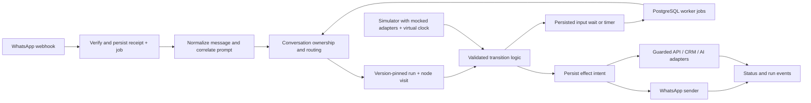

# BODHINOX complete conversation flow builder: research and build blueprint

Status: **proposal for review; not implemented or approved for implementation**.

Research date: 24 October 2026. Evidence: current BODHINOX source, the authenticated AiSensy inspection recorded in `aisensy-flow-builder-extraction.md`, and official documentation linked below. This is an engineering recommendation, not a claim to have recovered AiSensy's private backend. No application code, database, account configuration, production service or customer message was changed by this research.

## 1. Recommendation and scope

Extend the existing BODHINOX flow editor and runtime. Keep React Flow, TypeScript, Next.js, Prisma/PostgreSQL, the Railway worker, current WhatsApp integration, and existing AI providers. Add immutable published versions, durable step execution and a simulator before expanding the node library.

The goal is a complete **WhatsApp conversation builder** comparable to the inspected AiSensy product: message menus, data collection, conditions, routing, external APIs, commerce, handoff, AI assistance, templates, testing, publishing and diagnostics. It should retain BODHINOX's cream/copper design and existing saved flows.

Three approaches were considered; this recommendation is my assessment, not a user-selected or approved implementation choice:

| Approach | Benefit | Cost and limitation | Assessment |
| --- | --- | --- | --- |
| Extend the current editor plus durable PostgreSQL execution | Reuses the deployed stack, tenancy, worker, WhatsApp sending, AI and existing flows | Requires deliberate versioning, step state and integration work | Recommended |
| Retain the editor but adopt Temporal or another durable workflow backend | Strong orchestration primitives for long-running, parallel workflows | New service, operations, workflow migration and a second execution model | Reconsider when workflow complexity or measured scale justifies it |
| Replace the builder with an embedded external automation product | Faster access to generic connectors | Separate permissions, secret storage, deployment, UX, licensing and conversation ownership; WhatsApp behavior still needs integration | Poor fit for the current parity goal |

React Flow supports node interaction and graph-state persistence; its frontend graph is not the durable server executor for customer conversations. Reuse its UI capabilities while persisting execution independently. [React Flow computing guide](https://reactflow.dev/learn/advanced-use/computing-flows), [save/restore example](https://reactflow.dev/examples/interaction/save-and-restore).

### Two different meanings of “flow”

1. **Conversation flow:** BODHINOX controls chat messages, waits, branches and API actions on its server. This is the main scope.
2. **Meta WhatsApp Flow:** an in-WhatsApp multi-screen form using Meta's Flow JSON, publication and completion/data-exchange protocols. Add this as an optional node/integration in the conversation builder; it is a separate subsystem, not automatically produced by drawing a chat graph. Dynamic data exchange additionally needs endpoint encryption and key management. [Meta sending guide](https://developers.facebook.com/documentation/business-messaging/whatsapp/flows/guides/sendingaflow), [endpoint guide](https://developers.facebook.com/documentation/business-messaging/whatsapp/flows/guides/implementingyourflowendpoint).

“Complete” means every advertised node has a working editor, validation, runtime, integration, preview, failure path, logs and tests. It does not mean arbitrary business processes work without the required APIs, credentials, approvals or business data.

## 2. BODHINOX audit: what already exists

These are source findings, not fresh end-to-end production test results.

| Area | Current implementation | Implication |
| --- | --- | --- |
| Editor | `flow-editor-state.tsx` shares state between Canvas and List; dirty state, save, activation, deletion | Keep both views; improve the authoring experience rather than replacing it |
| Canvas | `flow-canvas.tsx`, `edges.ts`, `layout.ts`; draggable positions, minimap, pan/zoom, per-button/list-row/condition handles, connection/deletion cleanup, Dagre layout | The graph UI foundation already exists |
| Node library | `start`, `send_message`, `send_buttons`, `send_list`, `send_media`, `collect_input`, `condition`, `set_tag`, `handoff`, `end` | Ten implemented node kinds; extend their contracts incrementally |
| Triggers | Keyword exact/contains with case sensitivity, first inbound, manual; entry matching can use interactive-reply text | Add deterministic priority and source-specific triggers; do not break existing keyword behavior |
| Questions | Runtime Any/Email/Phone/Regex validation, regex worker isolation/deadline | Validation is implemented despite stale comments in some type documentation |
| Conditions | Run variable, tag, contact field; equals/contains/present/absent | Extend typed comparisons and business-hours checks |
| State and delivery | `flows`, `flow_nodes`, `flow_runs`, `flow_run_events`; run variables, active-run uniqueness, prompt message ID and retry count | Good starting point, but no published-version pin on runs |
| Failure handling | Unknown-reply reprompt/handoff/ignore/AI policies, retry cap, stale-flow sweep, 64-step advance cap | Preserve safeguards; add per-node timers, explicit states and recovery |
| Inbound integration | Persisted webhook receipts/jobs; checkpointed action stages; explicit quick-reply action, flow, awaiting automation, automation triggers and AI arbitration | Keep one responder path; strengthen ownership as new integrations arrive |
| Quick replies | Bound prompt-specific actions can start an existing automation or flow | Reuse this target-binding logic; it is not yet a general connect-flow node |
| Sending reliability | `dispatchOnce`, outbound intent records, ambiguous-send protection, lease-aware network calls | Reuse these primitives; do not replace them with blind retries |
| Jobs | PostgreSQL-backed queue, dedupe, run-at scheduling, leases, heartbeat, retry cap; deployed worker | Add flow step/timer jobs instead of adding Redis solely for this project |
| AI | Provider abstraction, account keys, knowledge retrieval, auto-reply eligibility and human/session checks | Reuse for explicit AI nodes, fallback and generation |
| Storage and payloads | Shared interactive-message validation/rendering, media storage and signing, Meta helpers | Reuse instead of creating flow-only uploads and previews |
| History/templates | Run-event viewer; starter-template API and cloning from template | Extend with version-aware filters, pagination, safe previews and original templates |

The foundation migration permits an `http_fetch` string in its database CHECK, but the flow runtime union, editor and executor do not implement that node. A schema value or comment is not evidence of a usable feature. Some reusable actions exist in Automations but are not exposed as flow nodes.

## 3. Engineering gaps to address first

These are static-analysis findings and source-derived risks. They were not reproduced against customer conversations.

| Priority | Finding and evidence | Required design response |
| --- | --- | --- |
| P0 | `src/app/api/flows/[id]/route.ts` updates the header, deletes nodes, then inserts replacements in separate operations; failed inserts or concurrent reads can see an incomplete graph | Atomic draft saves; publish immutable snapshots in a transaction |
| P0 | `flow_runs` has a `flow_id` but no version; `dispatchInboundToFlows` reloads the current `flow_nodes` for replies | Pin each run to an immutable published version and dependency versions |
| P0 | Activation invokes validation, but PUT can edit an already active flow without publishing a separately validated revision | Validate on publish; saving a draft never mutates the version serving customers |
| P0 | Sender keys use `run ID + node key + reprompt count`; revisiting a menu with the same retry count yields the same key | Persist a distinct node-visit/step-execution ID; retries reuse it, legitimate revisits do not |
| P0 | The inbound-stage checkpoint is per message, not a complete serialization contract for different messages arriving at the same run across workers | Transactional run revision checks plus per-conversation/run execution claims; verify under concurrent workers |
| P1 | Regular flow replies match the current node's reply ID; the richer prompt-context binding already used by quick-reply actions is not part of `ParsedInbound` | Bind replies to run/version/node visit and prompt; reject stale or mismatched selections |
| P1 | Unexpected dispatch errors can fall back to `consumed: false`/`no_match` | Distinguish no-match, owned-but-failed and retry/reconciliation states; do not let a failed owner silently hand the same message to another responder |
| P1 | Stale-run sweep reads at most 500 active runs; run history exposes the latest 50 | Cursor-based sweeping/history, due-time indexes and timer metrics |
| P1 | Flow deletion cascades into active runs/history | Archive and drain by default; audited deletion/retention policy rather than losing execution evidence |
| P1 | Flow-edit actions currently use the agent role | Introduce explicit author/publish/test/secret permissions, mapped to existing roles without silently revoking access |
| P1 | `src/lib/webhooks/ssrf.ts` explicitly documents a DNS-rebinding limitation | Reuse its IP parsing/rules but close the connect-time gap before offering arbitrary API-request nodes |

Additional boundaries: preserve the existing `authFetch`/CSRF mechanism; tenant-scoped database roles and server-side authorization must apply to every new endpoint. Existing checks are valuable and should be extended, not assumed absent.

## 4. AiSensy research: what is confirmed and what is not

The live inspection established the grouped palette, node canvas, keywords/regex, entry template/ad pickers, message/list/question editors, attributes, handoff, fallback controls, template gallery, testing-number section and AI onboarding. The recruitment flow contained 20 rendered nodes and 29 edge occurrences.

Official documentation fills important configuration details:

- API requests support GET/POST/PUT/PATCH/DELETE, parameters, headers, JSON bodies, test calls, response-to-attribute mapping and status-code routing. A “test” may make a real request; do not copy that label into a supposedly effect-free simulator. [AiSensy API tutorial](https://aisensy.com/tutorials/how-to-use-api-request-feature-in-chatbot-flow-builder), [builder guide, API configuration](https://wiki.aisensy.com/en/articles/11502564-how-to-create-drag-drop-whatsapp-chatbot-in-just-10-minutes-chatbot-flow-builder#h_9c86d5a6f9).
- The guide documents equality/existence conditions and time/date-range conditions, template-button triggers, ad-linked entry and text/image/video fallback. [AiSensy builder guide](https://wiki.aisensy.com/en/articles/11502564-how-to-create-drag-drop-whatsapp-chatbot-in-just-10-minutes-chatbot-flow-builder).
- Global attributes are intended for owner-managed sensitive configuration. Treat encryption and access behavior as a requirement for our implementation, not something proven about AiSensy's internal storage. [AiSensy global attributes](https://wiki.aisensy.com/en/articles/11502761-how-to-use-global-attributes-in-aisensy).

Limits can differ by account/version: the inspected entry block showed one template, whereas the guide describes three; the observed gallery contained 72 templates while product marketing describes a different minimum count. Do not hardcode competitor account quotas as WhatsApp restrictions.

Not fully verified: Connect Flow transfer/resume rules, Ask Media/Address/Location configuration, API node internals in the authenticated editor, commerce/payment completion, Meta conversion dispatch, AI execution/model choice, and actual test-number delivery. One API-template preview failed. Earlier REA analysis retained partial evidence after resource limits; it did not recover the full backend. The proposed contracts below settle these gaps for BODHINOX explicitly.

## 5. Complete feature inventory

Legend: **E** exists in flow source; **P** partially exists or exists elsewhere in BODHINOX; **N** needs implementation; **R** optional extension beyond the inspected conversation builder. Phase names refer to section 13.

| Feature | Status | Target behavior | Phase |
| --- | --- | --- | --- |
| Create, rename, description, list and delete | E | Add search, archive/drain and safe delete semantics | A/B |
| Canvas and List views | E | Retain shared canonical state | B |
| Typed ports and labeled edges | E | Stable button/row IDs independent of display text/reordering | A/B |
| Persistent node positions and layout | E | Preserve viewport; arrange selection/all; readable large graphs | B |
| Searchable grouped node palette | P | Messaging, Input, Logic, CRM, Routing, Integrations, AI | B |
| Inspector plus realistic WhatsApp preview | P | Compact node summaries and one inspector; field errors link to nodes | B |
| Undo/redo, duplicate selection, copy/paste | N | Local edit history; regenerate node/action IDs and validate pasted imports | B |
| Draft autosave and concurrent-edit protection | N | Debounced transactional saves with revision/ETag conflict UI | A/B |
| Publish, version history, rollback | N | Immutable revisions; rollback changes new-run pointer only | A |
| Keyword/first inbound/manual triggers | E | Backward compatible matching | A/B |
| Regex triggers and priority/conflict diagnostics | N | Safe bounded regex, deterministic winner, explain why a flow matched | C |
| Template-button entry | P | Explicit template/button binding with prompt context, not label guessing | C |
| Click-to-WhatsApp ad/referral entry | N | Preserve referral IDs and map to permitted flow targets | C |
| Signed external webhook/API start | P | Tenant-authorized, idempotent entry; deterministic conflict policy | C |
| Text, reply buttons and section lists | E | Shared payload validation and exact reply mapping | B |
| Image/video/document and captions | E | Shared upload/signing lifecycle; preview and expiry checks | B |
| Media-header reply buttons | P | Reuse interactive payload infrastructure in flow configs | C |
| URL CTA messages | P | A dedicated valid message type; URL navigation is not a reply event | C |
| Audio, contact card, outbound location | P | Explicit WhatsApp-supported node variants; no fake button combinations | D |
| Approved template message node | P | Template/locale/variable/media binding and approval/readiness checks | C |
| Question/input validation | E | Retain Any/Email/Phone/Regex; add per-field retry/error route | B/C |
| Number/date/boolean/choice formats | N | Typed capture, range and locale/timezone rules | C |
| Inbound file/image/video/audio capture | N | Enforce response kind, MIME/size, storage and attribute binding | C |
| Location and structured address capture | N | Preserve coordinates/structured data; eligibility fallback | D |
| Conditions | E | Typed comparisons plus explicit missing-value semantics | C |
| AND/OR groups, business hours, holidays | N | Named timezone, midnight ranges and testable clock | C |
| Set/update attributes | P | Separate run variables, contact fields, workspace settings and secrets | C |
| Tag add/remove | E | Reuse CRM mutations and event dispatch | B |
| Assign human/team, note and handoff | P | Stop bots, preserve transcript/summary, prevent late replies | B/C |
| Connect Flow / transfer | P | Atomically transfer ownership to a pinned published target | C |
| Reusable subflow with return | R | Explicit input/output contract and bounded call depth | E |
| Delay, wait-until and node timeout | P | Persist timers; no sleeping request/worker; cancel stale wake-ups | A/C |
| Stop, cancel, restart, reset variables | P | Explicit user-visible run lifecycle and safe restart confirmation | C |
| HTTP API request + mapping + branches | N | Server-side credentials, typed mapping, timeout/error/status routes | C |
| Contact/deal/pipeline actions | P | Expose existing authorized CRM services as flow actions | C/D |
| Outbound webhook / named automation action | P | Reuse delivery and action contracts without competing responders | C/D |
| Catalogue / single / multi product | N | Real catalogue IDs, product eligibility and order-event handling | D |
| Payments / checkout confirmation | P | Provider integration and verified payment webhook; no textual “success” shortcut | D |
| Meta conversion event | N | Isolated integration, tenant attribution, dedupe and diagnostics | D |
| Meta WhatsApp Flow form | N | Published/draft form handling, tokens, completion, optional encrypted endpoint | D |
| AI answer from selected knowledge | P | Explicit selected provider/KB and grounded answer/unavailable branches | C/E |
| AI intent/extraction | N | Validated finite labels/typed outputs; uncertain route, no arbitrary next-node selection | E |
| AI flow generation and prompt history | N | Generate a draft, validate, explain changes and require publish | E |
| Unknown reply and human fallback | E | Configurable reprompt/ignore/handoff/AI with clear ownership | B/C |
| Media and order-specific fallback | N | Typed fallback actions and order-event entry | C/D |
| Local simulator and step debugger | N | Same transition/validation logic, mocked effects and virtual clock | A/B |
| Draft WhatsApp test allowlist | N | Isolated test runs; exact recipients; no broadcast leakage | B/C |
| Template gallery, preview, search, import/export | P | Versioned original templates, dependency/secret rebinding and safe import | B/D |
| Run timeline, metrics and node failure overlay | P | Filter by version/mode/contact/outcome; retention and secret redaction | A/B/D |
| Granular author/publish/secret permissions | P | Server-enforced capabilities and auditable actions | A |
| Collaboration / approval workflow / A-B tests | R | Later, after reliable publishing and measured need | E+ |

Full parity means completing A through D plus the agreed AI authoring/assistance scope in E, not declaring completion after the first set of nodes. R items are optional; arbitrary code execution, unrestricted parallel DAGs and a generic marketplace are outside the recommended initial scope.

## 6. Editor experience

Keep BODHINOX branding. Use a searchable grouped palette on the left, canvas in the center and a single configuration inspector/WhatsApp preview on the right. Show compact content summaries in nodes; editing dozens of large textareas inline becomes difficult on larger graphs. Preserve List view for accessibility and smaller screens.

Top-level controls: flow name, draft revision, last saved state, Validate, Test, Publish, pause new entries, Versions and Run history. “Saved” and “Published” must be separate, unmistakable states. Preview must show the actual selected message type and its limitations.

Graph interactions: drag/tap to add, connect a named output, drag an output into empty space to add a next node, duplicate, multi-select, delete with inbound-reference cleanup, undo/redo, find node, fit/zoom/minimap and arrange layout. Selecting a validation issue focuses the node and its exact field. Keyboard alternatives must work without dragging.

Variable pickers distinguish run variables, contact fields, workspace settings, event metadata and secret references. Secrets never appear in customer-visible content choices. A broken media reference, deleted target flow or unpublished template is a publish blocker where required.

## 7. Definition, publishing and data model

### Canonical graph

Keep current node keys and embedded outgoing config links for compatibility. Use one shared typed node-definition catalogue to describe config schema, outgoing ports, editor form, preview, validation and executor. Eliminate independently maintained node-type enumerations gradually. Existing Zod is sufficient for schemas; no plugin framework is needed.

Compile a validated draft into a frozen runtime snapshot with schema version, node-config versions, resolved links/ports, dependency identifiers, trigger configuration, fallback policy, entry and content hash. Derived edge indexes are compiler output; do not maintain two independently editable edge authorities.

### Proposed additive tables/fields

| Record | Purpose |
| --- | --- |
| Existing `flows` | Stable identity, metadata, archived flag and published-version pointer |
| `flow_drafts` or a revisioned draft record | Editable graph, base published version, integer revision, editor state |
| `flow_versions` | Immutable definition JSONB/hash, schema version, author and publish timestamp |
| Extended `flow_runs` | Version ID, live/test/simulation mode, lifecycle, revision, execution owner and cancellation token |
| `flow_step_executions` | Unique node visit, input cursor, selected output, attempt/result/error state and effect IDs |
| `flow_waits` | Expected input, prompt/visit binding, deadline, timer generation and completion reason |
| Existing jobs/outbound intents | Durable scheduling and external-effect records; add contract variants rather than duplicating queues |
| Workspace variable/secret references | Typed settings; encrypted secret records and owner-managed access |
| Test sessions / recipient allowlist | Session-specific version, recipient, mode and expiry |
| Existing events plus publish audit | Redacted transition timeline, version metadata and aggregated counters |

Every record is tenant-scoped with enforced database policies, indexes and server checks. Proposed names are not migrations performed by this report.

Publish transaction: load the expected draft revision, validate config types and graph, verify external dependencies, freeze the snapshot and pin connect-flow target versions, then swap the published pointer and audit it atomically. A competing editor gets a conflict response, not a last-writer-wins overwrite. Drafts can be incomplete, but must always satisfy safe structural/payload-size constraints.

An active run stays on its pinned version. New entries use the current published version. Pause prevents new entries by default; “cancel existing runs” is a distinct action. Rollback republishes a known snapshot for future entries, without rewriting in-flight executions. Old versions remain available while referenced by runs or retention policy.

## 8. Execution architecture

### Lifecycle and ownership

Use explicit run states such as running, waiting-input, waiting-timer, waiting-effect, paused, handed-off, completed, failed, cancelled and reconciliation-required. The exact persistence vocabulary must remain compatible with existing constraints during rollout.

One conversation has one responder owner: human, active flow, explicitly waiting automation or eligible AI. Preserve the existing routing path and make its outcomes explicit. A signed/bound quick-reply action can request a controlled transfer; random text must not silently restart another flow or wake AI when a flow owns the conversation. No-match is different from owned-but-failed.

Use short database claims/revision checks, not a transaction held open across an LLM/API call. Each result must recheck its claim, conversation state, cancellation and window before applying a transition or sending. A human takeover invalidates pending bot work. Different message jobs may run concurrently across workers, so checkpointing one message cannot substitute for run-level serialization.

Persist a node-visit ID before scheduling an effect. Effect identity is based on account, run, node visit and output/effect slot; retries keep the same identity, while returning to a menu creates a new visit. Retain existing ambiguous-dispatch protection: a provider timeout can mean a message was accepted. Do not promise exactly-once delivery across third-party systems; provide at-least-once job processing with deduplication and explicit reconciliation for uncertain outcomes. Temporal's documentation makes the same distinction between retryable activities and deterministic orchestration. [Temporal retry policies](https://docs.temporal.io/encyclopedia/retry-policies), [activity idempotency](https://docs.temporal.io/activity-definition#idempotency).

### Reply binding, waits and cycles

Store expected input kind, stable choice IDs, prompt message ID, run/version and node visit. Normalize `reply_to_message_id`, inbound message ID, timestamps, arrival sequence, media metadata, locations and referral data without discarding their types. A stale “Yes” from an earlier menu cannot satisfy a new “Yes” prompt merely because the label matches.

Durable delay and timeout nodes create jobs with `run_at`; they do not keep a request or worker asleep. Timer jobs carry the wait ID/generation and expected run revision. Reply, timeout, cancellation and takeover compete through one atomic transition; a stale timer is a no-op. Recheck messaging eligibility after every wait.

Allow useful menu/back loops that include a real wait. Reject unbounded immediate cycles on publish, and retain runtime transition budgets. Bound total visits, subflow depth, elapsed time, message count and API/AI spending per run. Queue continuation for a large valid sequence instead of treating every chain exceeding today's 64-step batch as an error.

### API and integration node contract

Required fields: HTTPS endpoint, method, typed query/headers/body, server-side credential reference, request timeout, bounded response size, JSON extraction mappings, allowed status routes, timeout/network/parse routes and retry policy. Mapping must preserve numbers/booleans/arrays and distinguish absent from null, zero and false. Use a restricted selector language, not `eval` or tenant JavaScript.

Use mock responses in simulation. Provide separate sandbox and explicit real-call testing; a POST/PATCH/DELETE test may change an external system. Side-effect retries require a supported idempotency key or an explicit no-auto-retry/reconciliation policy. Never assume a booking, order or payment succeeded solely because the request was sent; verify the business result.

Reuse existing SSRF checks but add destination allowlisting where practical, DNS validation at connection time/pinning or controlled egress, IPv4/IPv6/private/metadata blocking, restricted ports, redirect controls, TLS verification and response limits. Protect credential destinations so a configured secret cannot be forwarded to an arbitrary URL through interpolation. [OWASP SSRF guidance](https://cheatsheetseries.owasp.org/cheatsheets/Server_Side_Request_Forgery_Prevention_Cheat_Sheet.html).

## 9. Variables, conditions, media and AI

### Data scopes and typed conditions

Separate ephemeral run variables, persistent contact fields, workspace business settings, secret references and immutable event context. Retain `{{vars.X}}` compatibility; expose an attribute picker rather than requiring AiSensy's `$name` syntax. External data and customer input are data, not executable instructions.

Condition types: equals/not-equals, contains, exists/missing, numeric comparisons, date comparisons, boolean, membership, tag presence, AND/OR groups and business hours. Show operators appropriate to the selected value type. Define trimming/case behavior, empty string vs missing, false/zero presence and error routes. Use named IANA timezones, UTC storage, explicit holiday calendars and overnight ranges. Business hours are not the WhatsApp service window.

Question nodes must define accepted message kinds, validation, capture destination, maximum retries, custom error prompt, skip/cancel behavior and timeout/handoff output. Do not store raw captured content in debug logs; sensitive values need retention and access rules.

### Message composition and storage

Reuse the interactive payload schema, renderer and media-upload services already shared with Inbox/Quick Replies. Flow builders should add configuration adapters rather than another media stack. Use storage references in saved graphs; issue provider-accessible URLs at send time so published flows do not contain an expired signed URL. Define replacement/deletion behavior and keep media referenced by live versions available.

A reply button creates an inbound reply event. A URL CTA opens a browser and does not provide the same reliable response event. A flow/automation action requires an opaque, prompt-bound reply action. Message types and headers must follow the selected WhatsApp capability; location is not an arbitrary media header. [Meta reply buttons](https://developers.facebook.com/documentation/business-messaging/whatsapp/messages/interactive-reply-buttons-messages), [URL CTA messages](https://developers.facebook.com/documentation/business-messaging/whatsapp/messages/interactive-cta-url-messages).

### AI integration

Offer explicit AI nodes for grounded answer, finite intent classification and typed extraction. Reuse the configured OpenRouter/Gemini/OpenAI/etc. provider abstraction and existing knowledge retrieval. Each node defines allowed knowledge sources, deadline, spending/reply caps, structured output schema, uncertain/error/handoff outputs and whether to stay at the current menu or advance.

For an unexpected but relevant text question at a menu, an opted-in AI fallback may answer and then keep the exact menu active. For unrelated input, missing knowledge or unavailable provider, reprompt or hand off according to policy; do not advance a choice node by guessing. AI must recheck ownership and the 24-hour window immediately before sending. Retrieval supplies reference context; it is not model training.

AI generation is a separate authoring operation: generate draft JSON using supported node schemas, validate, display assumptions and diff, run simulation and require normal publication. Generated API endpoints, products, credentials and successful business transactions cannot be invented. Tool access remains allowlisted; retrieved documents/API responses cannot authorize secret disclosure or extra actions.

## 10. WhatsApp platform boundaries

| Boundary | Builder/runtime response |
| --- | --- |
| Customer service window | Check at execution/send time. A delayed free-form message may no longer be eligible; use a configured approved template or pause/handoff. Sending a template alone does not establish that the customer replied |
| Reply buttons | Up to three; validate IDs and display lengths independently of routing identity |
| Lists | At most ten rows across all sections, not ten per section; list choice is one selected row |
| Payload text and media limits | Reuse central limits and validate again after variable interpolation; raw graph text fitting does not guarantee expanded content fits |
| Templates | Verify approved status, correct language, variable bindings, header sample/media and appropriate account readiness |
| Structured address request | Current Meta page limits this feature to India-based businesses and India customers; hide/gate it or provide a question/Meta-Flow alternative elsewhere |
| Ordering | API acceptance is not delivery. Where strict multi-message order matters, handle delivered-status sequencing, timeout and fallback explicitly |
| Consent, opt-out, quality and quotas | Apply platform rules and user preferences to all entry points, timers, campaigns and retries |
| Product/payment/form capability | Require actual account eligibility and integration readiness; do not expose a misleading working node when prerequisites are missing |

Meta documents the 24-hour window and approved templates outside it, as well as delivery-order caveats. [Service messages](https://developers.facebook.com/documentation/business-messaging/whatsapp/messages/send-messages). Current list and address behavior is documented separately. [List messages](https://developers.facebook.com/documentation/business-messaging/whatsapp/messages/interactive-list-messages), [Address messages](https://developers.facebook.com/documentation/business-messaging/whatsapp/messages/address-messages).

Before implementation, validate numeric limits against the pinned Graph API version and shared constants; avoid copying sample API versions from old tutorials. BODHINOX currently centralizes 3 buttons, 20-character button labels, 10 total rows, 24-character list titles, 72-character row descriptions, 1024-character interactive bodies and 60-character text header/footer limits.

## 11. Testing, observability and operational controls

Three distinct modes must be visible and enforced on the server:

1. **Simulation:** no WhatsApp sending, no real CRM mutation, no real payment/API calls; mocked effects, seeded contact, virtual clock, optional explicitly enabled live LLM test. Run the same transition, interpolation and validation logic as production.
2. **WhatsApp test:** a pinned draft version with exact allowlisted recipients and isolated run state. Explicitly select sandbox vs real external effects. Publishing is not required, but permission and service-window checks still apply.
3. **Live:** published versions only, real effects, full ownership and audit policies. A draft save never changes this mode.

Simulator functions: text/button/list/media/location inputs, step/continue, show selected edge, inspect redacted variables, move clock, inject API error/rate limit, simulate human takeover and replay a sanitized scenario. It must identify mocks and cannot claim a real payment/delivery was verified.

Run view: version and mode, contact, current visit, last inbound, ownership, transition timeline, effect/provider IDs, timer deadline, retry status, classified failure and reconciliation controls. Aggregate entry/completion/drop-off/handoff/error metrics by version/node, plus API latency, AI latency/cost, queue lag and timer lateness. Do not expose secrets or raw sensitive payloads in logs/export.

Queue operations: bounded concurrency across conversations with per-run serialization; separate slow AI/API tasks from message-ingestion capacity as measurements demand. Paginate sweeps, monitor failed/reconciliation queues and preserve cancellation. Large worker replicas must be tested with lease loss and restart; a lease alone does not supply business idempotency.

Permissions: author drafts, publish/rollback, manage secrets, run live API tests, manage test recipients, inspect sensitive run data, cancel/drain and administer integrations. Preserve current account roles through explicit mapping; enforce permissions in APIs and database scope, not only hidden buttons.

## 12. Migration and compatibility

1. Inventory real saved node kinds/config shapes, active runs, referenced media and trigger collisions using authorized read-only queries before implementation. This research did not read production database rows.
2. Add schema and feature flags without switching execution. Keep the existing runtime path available.
3. Introduce transactional legacy draft saves, then snapshot/compile existing definitions into schema-versioned published versions. Validate unsupported `http_fetch` rows explicitly rather than guessing their behavior.
4. Pin active runs through a documented drain or migration policy. A snapshot of today's graph cannot reconstruct the exact historical graph of a run that started before prior edits; disclose and handle this limitation.
5. Preserve node/reply IDs and variable syntax. Keep existing template and Quick Reply start contracts working. Compare old/new transitions using recorded synthetic fixtures without duplicating external sends.
6. Enable simulator and internal test recipients; then opt-in accounts and a small live cohort. Freeze/pin subflow dependencies and media references.
7. Promote only after acceptance gates. Rollback routes new entries to an older version; already-started new-schema runs either finish with their compatible executor or are deliberately handed off. Rolling back code without a compatible reader for stored state is not safe.

Do not rewrite all Automations into Flows in the same release. Share validated actions and ownership policy first; a later product decision may unify their UI or authoring model.

## 13. Delivery phases and completion gates

No time/cost estimate is reliable without an implementation spike and agreed parity scope. Use the following dependency order and evidence-based gates instead.

| Phase | Deliverables | Release gate |
| --- | --- | --- |
| A — Foundation | Transactional drafts, publish snapshots, run pinning, visit IDs, typed contracts, ownership/claim rules, durable waits, redacted events | Editing/publishing/retry/restart cannot alter an in-flight version or duplicate known accepted effects; concurrency and rollback checks pass |
| B — Author and simulate | Palette/inspector/preview, keyboard/undo, validation, local simulator, original starter templates, version-aware history | A complete menu/question/handoff journey works in simulation and existing flows retain behavior |
| C — Conversation parity | HTTP requests/status mapping, attributes, richer validation/conditions, delays/timeouts, transfer flow, template/ad triggers, draft test numbers, explicit AI fallback | Each new node has editor/schema/runtime/preview/error routes/tests; end-to-end sandbox WhatsApp paths and isolation pass |
| D — Commerce and integrations | Catalogue/products, real order/payment events, Meta conversion action, structured location/address, Meta Flow forms, CRM actions and gallery expansion | Each integration passes provider prerequisites, real sandbox confirmation, failure handling and secret redaction |
| E — AI authoring and refinements | Validated intent/extraction, draft generation/diff/history, selected website knowledge ingestion; optional reusable subflows/advanced collaboration | Provider failure/unsupported model/unrelated input/uncertain knowledge cannot trigger unapproved side effects or publication |

“All AiSensy-like functionality” is a substantial product expansion, not one UI task. The node list alone is not a completion checklist.

## 14. Acceptance scenarios

| Scenario | Required result |
| --- | --- |
| Edit active flow while customer waits | Existing run uses its pinned version; new run uses published version only |
| Save fails or two editors save together | No partial graph; one explicit conflict/failed-save response; published version unaffected |
| Return to a previous menu | A fresh menu prompt is sent with a new visit identity; a retry of that visit does not send twice |
| Old button tap or ambiguous text “Yes” | No wrong-branch advance; stale/unmatched event is handled by declared policy |
| Duplicate webhook and two rapid distinct replies | Duplicate causes no extra effect; distinct replies serialize deterministically |
| Timeout and reply arrive together | Exactly one wait transition wins; the other becomes a no-op or declared late-input route |
| Worker crashes after provider accepts send | Accepted result is reused when known; ambiguous outcome enters reconciliation, not blind resend |
| Human takes over during LLM/API/delay | Pending bot result cannot send or mutate ownership afterward |
| Input contains invalid email/media/regex/date | Bounded validation, custom retry/error branch and no crash |
| Condition sees false, zero, null or missing | Distinct, documented typed semantics; no implicit truthiness surprises |
| API returns 200/404/429/500, malformed JSON or hangs | Correct route, bounded retries/deadline, safe redacted diagnostic |
| API points at private IP, redirect or rebinding target | Request blocked; credentials never transmitted to an unapproved destination |
| Time delay passes the service-window boundary | No invalid free-form send; approved template/pause/handoff policy applies |
| Simulation runs a payment or POST node | Mock effect only unless a separate explicit live/sandbox operation was chosen |
| Draft WhatsApp test targets a non-allowlisted number | Server rejects it before any outbound effect |
| Connect target changes, is archived or belongs to another tenant | Pinned/allowed target only; error branch, no cross-tenant access |
| AI receives unrelated input or prompt injection in API/KB text | No fabricated business outcome; valid bounded answer, reprompt or human fallback |
| Template/catalogue/media dependency becomes invalid | Readiness error with actionable recovery; no silent success |
| Large valid flow, multiple workers and backlog | Bounded processing, persistent continuation, no starvation; latency and queue-lag measurements recorded |
| Legacy flow and Quick Reply starts | Existing syntax, ownership and customer-visible behavior preserved |

Cross-cutting tests: unit graph/condition/validator tests; PostgreSQL integration for publish/claims/timers/tenancy; contract fixtures for webhook/payload variants; simulator-production transition equivalence; browser editor tests; provider sandbox tests; load/restart/lease-loss and rollback rehearsal. No fresh suite was run for this documentation-only research task.

## 15. Code touchpoints for a future implementation

| Work package | Existing files/services to extend |
| --- | --- |
| Node catalogue and shared contracts | `src/lib/flows/types.ts`, `validate.ts`, `edges.ts`; `src/components/flows/shared.tsx` |
| Editor and preview | `flow-editor-state.tsx`, `flow-editor-shell.tsx`, `flow-canvas.tsx`, `flow-builder.tsx`, `forms/node-config-form.tsx`, shared interactive preview |
| Save/publish/version APIs | `src/app/api/flows/route.ts`, `[id]/route.ts`, `[id]/activate/route.ts`; new version/test contracts; Prisma schema/migrations and tenant grants |
| Runtime, waits and ownership | `src/lib/flows/engine.ts`, `fallback.ts`; `src/lib/whatsapp/inbound-actions.ts`, `ingest.ts`, `quick-reply-actions.ts` |
| Effect and job reliability | `src/lib/jobs/queue.ts`, `handlers.ts`, `dispatch.ts`, `lease.ts`; flow send helpers and outbound intents |
| Rich input and triggers | `process-webhook.ts`, inbound contracts, prompt correlation, media mirroring and send-target normalization |
| HTTP integrations and secrets | Existing webhook SSRF/delivery and encryption services; server-side credentials; extend with connect-time enforcement |
| AI nodes and generation | `src/lib/ai/config.ts`, `knowledge.ts`, `generate.ts`, `auto-reply.ts` and existing provider contracts |
| History and template gallery | Flow list/runs pages, runs API, `src/lib/flows/templates.ts`, localized message catalogues |

Before future Next.js changes, read the installed `node_modules/next/dist/docs/` guides as required by this repository. This blueprint adds no dependencies or application code.

## 16. Source register and remaining decisions

Primary sources consulted:

1. [AiSensy builder tutorial](https://wiki.aisensy.com/en/articles/11502564-how-to-create-drag-drop-whatsapp-chatbot-in-just-10-minutes-chatbot-flow-builder) — nodes, triggers, branching, fallback, handoff and API status routes.
2. [AiSensy API-request tutorial](https://aisensy.com/tutorials/how-to-use-api-request-feature-in-chatbot-flow-builder) — request configuration and attribute capture.
3. [AiSensy global attributes](https://wiki.aisensy.com/en/articles/11502761-how-to-use-global-attributes-in-aisensy) — owner-managed sensitive configuration.
4. [Meta service messages](https://developers.facebook.com/documentation/business-messaging/whatsapp/messages/send-messages) — messaging eligibility, types, delivery caveats.
5. [Meta reply buttons](https://developers.facebook.com/documentation/business-messaging/whatsapp/messages/interactive-reply-buttons-messages) — reply-button sending and webhook contract.
6. [Meta lists](https://developers.facebook.com/documentation/business-messaging/whatsapp/messages/interactive-list-messages) — combined row limits and selection event.
7. [Meta URL CTAs](https://developers.facebook.com/documentation/business-messaging/whatsapp/messages/interactive-cta-url-messages) — navigation button type.
8. [Meta address requests](https://developers.facebook.com/documentation/business-messaging/whatsapp/messages/address-messages) — geographic eligibility and structured input.
9. [Meta Flow sending](https://developers.facebook.com/documentation/business-messaging/whatsapp/flows/guides/sendingaflow) — form messages, mode, tokens and template use.
10. [Meta Flow endpoints](https://developers.facebook.com/documentation/business-messaging/whatsapp/flows/guides/implementingyourflowendpoint) — encrypted data exchange.
11. [React Flow computing](https://reactflow.dev/learn/advanced-use/computing-flows), [validation](https://reactflow.dev/examples/interaction/validation), [save/restore](https://reactflow.dev/examples/interaction/save-and-restore) — editor primitives.
12. [Temporal retries](https://docs.temporal.io/encyclopedia/retry-policies), [idempotent activities](https://docs.temporal.io/activity-definition#idempotency) — durability tradeoffs, not a recommendation to install Temporal now.
13. [OWASP SSRF prevention](https://cheatsheetseries.owasp.org/cheatsheets/Server_Side_Request_Forgery_Prevention_Cheat_Sheet.html) — external-request controls.

Open implementation decisions: which commerce/payment providers to support first; which external APIs and test environments exist; whether reusable subflows need return semantics; desired publish permissions; retention/volume targets; initial gallery categories; and whether native Meta forms are needed in the first parity release. Recommended defaults above are proposals, not recorded user approvals.

The report covers observed and documented parity plus the operational foundations needed to build it reliably. It is not an exhaustive certification of AiSensy's hidden implementation or all present/future Meta capabilities. Recheck provider capability/version details during implementation.
