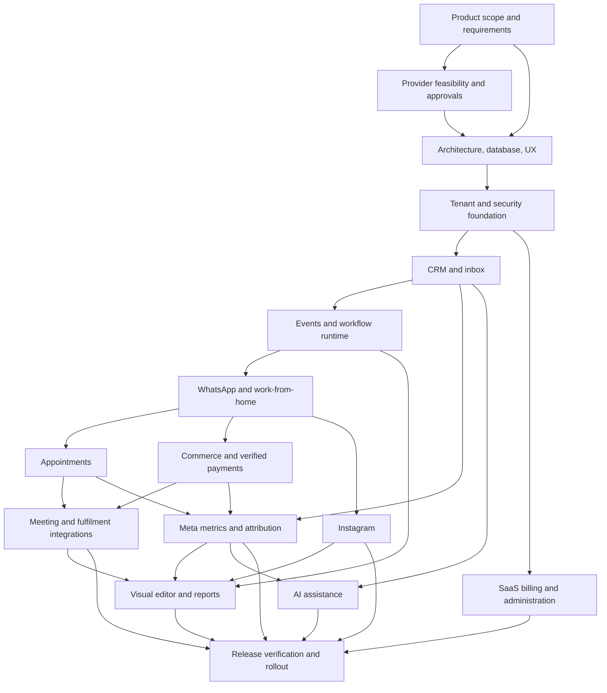

# Bodhinox Chat — execution roadmap

Date: 13 October 2026

Status: initial product requirements locked as v1.0 on 13 October 2026; this document remains the high-level engineering sequence. No application implementation, dependencies, provider accounts, or deployments have been created. The [product requirements baseline](../specs/2026-10-13-bodhinox-chat-product-requirements.md) controls product scope/defaults; detailed technical plans follow later.

Source: the complete 23-section master prompt and the user's Step 1 direction. The source attachment uses “Bodinix”; the user has confirmed the exact product name as **Bodhinox Chat**. Preserve the original attachment and use the confirmed name in working documents.

## 1. Intended outcome

Build a multi-tenant business platform for Indian businesses, initially validated with the four healthcare/wellness journeys. One customer profile connects lead capture, WhatsApp/Instagram conversations, sales activity, appointments, purchases, verified payments, fulfilment, feedback, and advertising attribution. Industry-specific services, schedules, products, forms, pipelines, and automation templates must be configurable.

The first market is India. Use INR as the pilot reporting currency and Asia/Kolkata as the initial business timezone, with tenant-configurable timezone and currency-aware data for future expansion. Multi-currency operation and implicit FX conversion are not pilot scope. Store timestamps in UTC and preserve the relevant timezone for scheduling. Store money in currency-aware minor units; avoid floating-point financial arithmetic.

The workspace had no existing application when first inspected; it currently contains planning documents only. Therefore this is a new-project roadmap. Before implementing each phase, translate it into a smaller module specification, API/data contracts, engineering tasks, and acceptance tests. Exact source files and commands should be defined at that point, once the application structure exists.

## 2. Delivery approach and alternatives

Recommended: a modular TypeScript monolith with a web application, API process, and asynchronous worker. Shared domain services and contracts keep customer data and business outcomes connected while separating responsibilities.

Alternative: put all backend logic inside Next.js. This can simplify a smaller first prototype, but this project's queues, webhooks, durable automation, and integration lifecycle justify a dedicated API and worker.

Alternative: separate microservices from the start. This adds deployment and consistency work before the team has evidence of independent scaling needs. Revisit only when measured load or organizational boundaries justify it.

Recommended starting stack, drawn from the master prompt:

| Responsibility | Proposed choice |
|---|---|
| Web dashboard and public booking/store pages | Next.js, React, TypeScript |
| UI | Tailwind CSS and one accessible component system |
| API/domain modules | NestJS, TypeScript |
| Data | PostgreSQL with Prisma and reviewed SQL migrations/policies |
| Jobs | Redis and BullMQ |
| Workflow editor | A maintained React node editor, selected during its phase |
| Inbox updates | Server-sent events initially; WebSockets if measured needs require them |
| Media/files | S3-compatible object storage |
| Authentication | A vetted maintained authentication solution; select after confirming hosting and account requirements |
| Payments | One authorized UPI-capable gateway; Razorpay is a candidate, subject to merchant eligibility and commercial review |
| Testing | Unit/service tests, real PostgreSQL integration tests, provider contract tests, browser end-to-end tests |
| Hosting | Docker-capable API/worker hosting, managed PostgreSQL/Redis, storage, HTTPS, separate staging and production |

Pin supported dependency versions during implementation using official documentation. A worker must have a suitable long-running runtime; scheduled workflows must not depend on a web request remaining alive.

Conceptual repository boundaries: web app, API app, worker app, shared request/event contracts, UI system, database/migrations, provider adapters, tests, and documentation. Share domain logic between API and worker instead of duplicating booking, payment, or messaging rules.

## 3. Release boundaries

### Release A: internal alpha

Tenant accounts, CRM, inbox, reliable events/jobs, and one complete WhatsApp lead-registration journey. Provider simulation is explicitly labeled. Basic appointment and commerce services are added and tested before presenting their journeys as complete.

### Release B: WhatsApp business pilot

All four menu journeys work: work-from-home onboarding, free consultation, chiropractic booking, and Ayurvedic product purchasing. Include verified payment handling, stock safeguards, fulfilment status, feedback, opt-out handling, agent takeover, preset automation, essential dashboards, basic ad-spend synchronization, and attributable revenue where evidence exists. Test with an initial business, then a second isolated tenant.

This pilot intentionally uses WhatsApp as the primary channel. Instagram is included in the next release; the full lifecycle described in the master prompt is not declared delivered until its required channels and acceptance gates are ready. Native messaging catalogs are optional for the pilot: permitted secure web booking/store links can carry the transaction where channel/account capabilities are unavailable.

### Release C: complete customer lifecycle across channels

Add eligible Instagram messaging and comment workflows, a usable visual workflow editor, expanded Meta campaign/ad reporting, automated courier/meeting integrations, scheduled reports, AI assistance, self-service SaaS subscriptions, and complete administration.

### Release D: advanced product capabilities

Expand advanced commerce/retention options and explicitly authorized campaign/budget changes. The complete documented node catalog, configurable attribution windows/models, dynamic segments, lead scoring, and cost/expense estimates are required in Release C. Future agency/white-label capabilities are architectural considerations with separately specified later scope.

## 4. Data ownership and contracts

Design these entity groups before building screens:

| Domain | Core records and ownership |
|---|---|
| SaaS/identity | Tenants, users, memberships, roles/permissions, invitations, plans, subscriptions, billing, usage |
| CRM | Contacts, channel identities, companies, leads/opportunities, sources, tags, custom fields, pipelines/stages, tasks, notes, consent |
| Messaging/integrations | Connected accounts, credential metadata, conversations, messages/media, templates, webhook receipts, provider status history |
| Automation | Workflows, immutable published versions, nodes/edges, enrollment, executions/steps, scheduled actions, retries/dead letters |
| Appointments | Services, practitioners, locations/resources, availability/exceptions, bookings, attendance, meeting references, feedback |
| Commerce | Categories, products/SKUs/variants, prices, addresses, carts, stock reservations, inventory movements, orders/items, discounts, invoices |
| Payments/fulfilment | Payment attempts, verified transactions, refunds, reconciliation records, shipments, tracking events, returns |
| Marketing/reporting | Campaign/ad account hierarchy, daily metric snapshots, touchpoints, conversion/attribution records, cost inputs, report jobs |
| Platform reliability | Transactional outbox, processed-event records, audit logs, integration health, correlation identifiers |
| AI | Tenant knowledge sources, retrieval metadata, model usage, suggestion/evaluation records with retention controls |

Every tenant-owned record carries tenant scope. Enforce scope in request handling, database policies, workers, cached data, real-time streams, storage authorization, and exports. Use tenant-aware unique constraints and references. Database row-level security must use a non-bypass application role and transaction-scoped tenant context, including with connection pooling; test it with the actual runtime configuration.

One contact may have several leads/opportunities, conversations, appointments, and orders. An Instagram username or similar name is insufficient evidence to merge identities. Normalize phone numbers and merge only through reliable identifiers or an audited human decision. Preserve historical attribution when contacts merge.

Define shared event envelopes with tenant, event ID/version, event type, subject, time, and correlation ID. These are internal contracts, distinct from external provider event names. Record an event in the database transaction with its business change; publish it through an outbox worker. Delivery is at least once, so consumers must prevent repeated effects.

All outbound messages pass one dispatch policy check for tenant permissions, current consent, provider eligibility/window/template rules, plan quotas, and current business status. Apply the check at send time even if the action was scheduled earlier.

Separate customer commerce payments from businesses paying for Bodhinox subscriptions. Locked initial funds model: each tenant connects an appropriate merchant account and receives its own customer funds. A marketplace settlement model would require a separate financial/compliance design and baseline change before commerce implementation.

## 5. Execution phases

### Phase 0 — product brief and release baseline (Step 1 completed)

Dependencies: none.

- [x] Confirm **Bodhinox Chat**, India-first healthcare/wellness templates, the four journeys, product ownership and staged pilot scope.
- [x] Write PRD v1.0 with 70 requirement IDs, releases, priorities, functional accountabilities and acceptance evidence.
- [x] Define tenant/platform roles and explicit export, refund, sensitive-data and support-access boundaries.
- [x] Define the four journeys, human takeover, opt-out, failure paths and scoped customer links.
- [x] Lock initial business-rule defaults; retain actual schedules, prices, catalog and session details as required tenant setup inputs.
- [x] Define consent/retention/data-request and tax/receipt requirements; record policy/business review as a live prerequisite.
- [x] Freeze cumulative A/B/C/D release boundaries, initial performance/recovery targets and pilot completion gates.

Step 1 deliverables: [PRD v1.0](../specs/2026-10-13-bodhinox-chat-product-requirements.md), [requirement matrix](../../product/bodhinox-chat-requirements-v1.0.csv), and [gap review](../../product/2026-10-13-bodhinox-chat-requirements-review.md). Named staff/business assets, budget/team/date and provider approvals remain setup/scheduling inputs rather than fabricated completed decisions. All application features are still planned.

Deliverables: PRD, release scope, role matrix, journey diagrams, requirement/acceptance matrix, initial risk register.

Completion gate: each required module has an owner, release, and observable outcome. Open product decisions are explicitly assigned before their dependent phase begins.

### Phase 1 — start provider feasibility and approvals

Dependencies: Phase 0 initial business model. This work overlaps design and foundation work.

- [x] Research current official provider prerequisites and prepare the beginner setup sequence, capability matrix and account/approval tracker on 13 October 2026. User reports starting from zero and an existing WhatsApp Business app number; account eligibility is unverified.
- [ ] Inventory Meta business assets, WhatsApp number/business account, Instagram professional account, ad accounts, gateway merchant accounts, meeting/courier providers, domain and email needs.
- [x] Compare onboarding for the platform owner's test assets against unrelated customer businesses; document test sender, eligible existing-number coexistence, Embedded Signup v4, Tech Provider/approved partner routes and account ownership boundaries.
- [x] Create a research-supported capability matrix: prerequisites, permissions, reviews, windows/templates, documented limits/events, fee checks and fallbacks. Individual eligibility, current commercial terms and actual live proof remain pending.
- [ ] Validate current channel/provider policies for the actual business categories and product catalog; a website fallback must not bypass prohibited product or messaging policies.
- [x] Identify HTTPS callbacks, privacy/disconnection/data-deletion, OAuth and credential lifecycle prerequisites; actual endpoint contracts/URLs follow in architecture and development.
- [ ] Prepare review demonstrations when the relevant working screens exist. Do not claim account approval before it is granted.
- [x] Define preparation/test/review/approved/live-verified states and observable release evidence. Actual provider tests remain pending.

Prepared Step 2 deliverables: [beginner setup guide](../../integrations/2026-10-13-bodhinox-chat-integration-setup-guide.md), [capability matrix](../../integrations/bodhinox-chat-integration-capability-matrix.csv), and [account/approval tracker](../../integrations/2026-10-13-bodhinox-chat-integration-setup-tracker.md). The guide reflects current v4 onboarding and October 2026 WhatsApp billing changes. No external accounts have been created/inspected, permissions approved, or real number migrated/connected by this work.

Remaining deliverables: account-specific feasibility results, policy decisions, actual approval/review evidence and detailed integration contracts in the dependent architecture/implementation phases. Research preparation is complete; live readiness is not established.

Completion gate: the team knows what can be implemented now, what needs external approval, and the exact prerequisite for each live capability.

### Phase 2 — architecture, database, and product design

Dependencies: Phase 0; Phase 1 findings constrain integration design.

- [ ] Approve module ownership, entity relationships, shared event contracts, API contracts, and lifecycle state diagrams.
- [ ] Define contact matching, booking conflict protection, inventory reservations, payment/refund transitions, workflow version semantics, and attribution rules.
- [ ] Design tenant isolation and security boundaries; include worker and export access.
- [ ] Design the navigation, onboarding, inbox, contact timeline, appointments, store/checkout, integration health, reports, and automation screens.
- [ ] Create a consistent accessible UI system and responsive critical flows; include empty, pending, disconnected, failed, and success states.
- [ ] Define operational targets: pilot traffic assumptions, agreed latency/reliability targets, backup recovery targets, and cost envelope.

Deliverables: architecture/data-flow diagrams, ER diagram/data dictionary, API/event specifications, clickable design, threat model, test/deployment standards.

Completion gate: an engineer can trace a lead to a booking or order and payment without conflicting data ownership or missing interfaces.

### Phase 3 — SaaS foundation and development environment

Dependencies: Phase 2 contracts and design.

- [ ] Establish the repository, local development workflow, API/web/worker applications, migrations, configuration template, and explicitly labeled demo seeds.
- [ ] Implement authentication, recovery, organization creation/switching, invitations, permission checks, and secure sessions.
- [ ] Enforce tenant isolation in database and application access; add audit logging, secrets management, rate limits, upload controls and error handling.
- [ ] Add configurable feature entitlements and usage-recording foundations; payment collection for SaaS subscriptions arrives later.
- [ ] Establish separate development/staging/production configurations, CI checks, structured logs, monitoring, backup policies, and safe migration deployment.

Deliverable: a usable organization workspace with settings, roles and the approved application shell.

Completion gate: two organizations can work independently; neither can access the other's data, files, jobs or streams, including by changing resource IDs or tenant selectors.

### Phase 4 — CRM and inbox foundation

Dependencies: Phase 3.

- [ ] Implement contacts, companies, channel identities, multiple leads/opportunities, sources, consent history, notes, tasks, tags, custom fields, configurable pipelines and stage rules.
- [ ] Add search, filters, saved views, static lists, permission-controlled CSV import/export, assignment and round robin for B; extend to dynamic segmentation and deterministic scoring in C.
- [ ] Implement duplicate detection and audited merge previews with historical record preservation.
- [ ] Create shared conversations/messages, unread state, assignment, saved replies, internal notes, attachments and staff activity timelines.
- [ ] Add website forms, manual lead capture and authenticated external lead/webhook ingestion using the same CRM services.
- [ ] Record available campaign/referral touchpoints from first ingestion; enrichment and reports follow later.

Deliverable: operators can receive, find, assign and progress a lead in one workspace.

Completion gate: returning contacts match safely; different opportunities remain distinguishable; imports/merges cannot leak data or destroy their history.

### Phase 5 — reliable event engine and preset automation runtime

Dependencies: Phases 3–4. Build this before the visual editor or live scheduled reminders.

- [ ] Implement outbox publication, authenticated webhook receipt persistence, event deduplication, queues, scheduled actions, retries with backoff, failure isolation and dead-letter inspection.
- [ ] Implement versioned workflow definitions and executions with triggers, conditions, branches, delays and domain action contracts.
- [ ] Add execution limits, loop prevention, pause/cancel, dry run, explicit retry/replay eligibility and correlation IDs.
- [ ] Define agent takeover rules so automation cannot compete with staff; resumption is explicit or governed by the configured rule.
- [ ] Implement central messaging dispatch checks and send-time checks for stale appointment/order state and changed consent.
- [ ] Handle provider timeout after submission as an uncertain outcome; reconcile where supported and avoid blind duplicate sends.

Deliverable: reliable preset workflows with execution history, independent of a canvas editor.

Completion gate: duplicate events, worker restarts and retries do not repeat business effects; obsolete jobs are blocked even if queue cancellation races with dispatch.

### Phase 6 — WhatsApp connection and work-from-home journey

Dependencies: Phases 4–5 and Phase 1 account/capability prerequisites.

- [ ] Implement the official provider adapter, account/number configuration, webhook verification/signatures, inbound normalization, status updates, media and template synchronization where supported.
- [ ] Implement integration health, revoked/expired credential handling, reconnection and permitted human replies.
- [ ] Present the four options through an eligible list/menu with clear shortened titles/descriptions, or a numbered-text fallback. Select message formats using current provider limits.
- [ ] Build work-from-home registration: name, normalized phone, city/state, consent, CRM update, campaign association, welcome, invitation instructions, session details, reminders and follow-up.
- [ ] Track invitation sent separately from verified joining; use verified meeting attendance where available or clearly labeled staff records.
- [ ] Add the routes to booking/store services as those phases become ready. Do not mark them functional before those services exist.

Deliverable: the first complete messaging-to-CRM onboarding journey.

Completion gate: a permitted real inbound conversation creates/matches the contact, launches the selected journey, permits takeover, and preserves available source evidence. Simulator success alone does not pass the live gate.

### Phase 7 — appointments and the two consultation journeys

Dependencies: Phases 4–6.

- [x] Implement services, practitioners, locations, working hours, exceptions/holidays, capacity, duration/pricing and customer booking links.
- [x] Enforce Monday-only offline free consultation when enabled; keep it tenant/service configurable.
- [x] Implement atomic booking/conflict checks, confirmation, cancellation, rescheduling, staff notifications and customer status views.
- [x] Schedule one-day and two-hour reminders; skip times already passed for late bookings rather than sending overdue reminders immediately.
- [x] Replace reminders on rescheduling, cancel obsolete jobs and recheck booking version/status at dispatch.
- [x] Support configurable online meetings: initially an authorized supplied link; automatic meeting creation/attendance via approved integration when ready.
- [x] Implement consultation/chiropractic completion, attendance/no-show, feedback, next-step tasks and rebooking follow-up.

Deliverable: complete free-consultation and chiropractic journeys.

Completion gate: concurrent requests cannot overbook capacity; cancellation/rescheduling prevents obsolete messages; timezone and Monday rules survive date boundaries.

### Phase 8 — commerce, customer payments, and product journey

Dependencies: Phases 4–6 and approved merchant/payment model.

- [x] Implement categories, SKU/variants, images, reviewed descriptions/disclosures, pricing, inventory movements and alerts.
- [ ] Add product search/filtering, carts, quantity updates, addresses, coupons, shipping/tax configuration, totals and secure checkout.
- [x] Create pending orders and stock reservations transactionally with expiry rules; preserve price/tax/item snapshots.
- [x] Generate gateway orders/payment links/checkout sessions; verify signatures and authoritative payment status, amount, currency, merchant connection and internal order association server-side.
- [x] Deduplicate and tolerate out-of-order payment events. Separate payment authorization from confirmed capture/success according to the selected gateway contract.
- [x] Handle reservation expiry followed by delayed payment as a reconciliation exception; do not silently fulfil unavailable stock.
- [x] Implement receipts/invoices, order status history, cancellations, refunds, returns, and payment reconciliation.
- [x] Record fulfilment and feedback. Authoritative automated courier tracking arrives in Phase 9; audited staff-confirmed dispatch/delivery can serve the pilot and is labeled as staff recorded.
- [x] Connect the Ayurvedic menu path to permitted catalog messages or secure storefront links and product-specific follow-up.

Deliverable: a customer can buy a product and the business can reconcile its payment, stock and order.

Completion gate: duplicate webhooks create no duplicate financial effects; simultaneous purchases cannot oversell; checkout success screens alone never mark orders paid; refunds reconcile with reports and inventory rules.

### Phase 9 — meeting/courier integrations and follow-up completion

Dependencies: Phases 7–8 and provider prerequisites. B uses permitted audited staff-confirmed operations or verified provider events already available; automatic meeting/courier adapters below are required C scope.

- [ ] Add authorized Zoom/meeting creation, updates, session registration and attendance where the provider exposes verified data.
- [ ] Add one shipping/courier provider: shipment creation, tracking normalization, signatures where applicable and reconciliation.
- [ ] Guard against repeated/out-of-order tracking and contradictory delivery events.
- [ ] Trigger dispatch/delivery notices, post-session/visit/delivery feedback and consent-based repeat-purchase follow-up.

Deliverable: all four journeys connect to operational fulfilment with evidence-labeled statuses.

Completion gate: automated attendance/delivery claims use provider-confirmed data; unavailable events remain unknown or staff recorded.

### Phase 10 — Meta Ads intelligence and revenue attribution

Dependencies: Phase 4 source capture; Phases 7–8 outcomes and money records; Phase 1 ad permissions. Read-only spend synchronization can start alongside the pilot without waiting for every fulfilment feature.

- [ ] Connect eligible ad accounts through official authorization; synchronize campaign/ad-set/ad hierarchy and daily metrics.
- [ ] Support pagination, rate limits, retries, sync health, reconnect, historical backfill and corrections to mutable recent reporting dates.
- [ ] Preserve raw referral/UTM evidence and enrich identifiers where exposed. Missing metadata stays unknown/unattributed.
- [ ] Locked B pilot model: last identifiable eligible marketing touch within 30 days before conversion. Record model/version and conversion-specific decision; C adds tenant-configurable windows and documented model choices.
- [ ] Keep Meta-reported conversions separate from CRM bookings, attended consultations, paid orders, refunds and attributed collected revenue.
- [ ] Build campaign/ad funnel metrics, spend alerts and date comparisons. Metric definitions state the population, currency, timezone and reporting basis.
- [ ] Compute CTR/CPC/CPL/ROAS and funnel rates from defined inputs; zero/unknown denominators display N/A.
- [ ] Require matching currency and consistent refund/tax treatment for financial ratios; show excluded/unknown revenue and attribution coverage.
- [ ] Add estimated contribution from actual product/fulfilment/gateway/advertising cost inputs. Show cost completeness; do not label it actual net profit when costs are missing.
- [ ] Provide approved read-only recommendations initially. Campaign creation, publishing or budget changes require separate permissions, explicit user confirmation, audit and configured safeguards in the advanced release.

Deliverable: an operator can trace available campaign evidence to verified business outcomes and understand report limitations.

Completion gate: sample totals reconcile to source records and provider metrics; refunds change the intended measures; attribution is presented as the selected model, not proof that an advertisement caused a sale.

### Phase 11 — Instagram and unified channel operation

Dependencies: Phases 4–6 shared inbox/runtime; Phase 1 eligible account/review results.

- [ ] Select the supported login/API route for the account and approved features; implement OAuth, token handling, webhooks, DMs and status/error handling where exposed.
- [ ] Add professional-account onboarding, permissions/health indicators, disconnect and reconnection.
- [ ] Implement supported keyword, welcome, private-reply/comment-to-message and handoff workflows within current restrictions.
- [ ] Reuse CRM, booking, commerce and dispatch-policy services; use channel-appropriate menus or web links.
- [ ] Link identities only with verified evidence or audited user decisions. Preserve otherwise separate Instagram and WhatsApp identities.

Deliverable: eligible Instagram conversations appear in the same operational inbox and launch the shared business services.

Completion gate: authorized live accounts work under the reviewed permissions; unsupported events are visible as unavailable; automation does not exceed permitted messaging behavior.

### Phase 12 — visual automation editor and reporting expansion

Dependencies: tested Phase 5 runtime and stable domain actions from Phases 7–11.

- [ ] Add a node editor with a registry of only implemented triggers, conditions and actions. Cover the master prompt's complete documented node catalog in C; unavailable provider actions expose their specific capability block.
- [ ] Add validation, draft/publish/pause/archive, immutable published versions, dry runs, run histories, retry inspection and permission-controlled replay.
- [ ] Keep running executions pinned to their published version. Define whether edits affect future enrollments only; require explicit migration/cancellation for active runs.
- [ ] Add reusable templates for the four business journeys, dynamic segment enrollment and controlled internal/external notifications/webhooks.
- [ ] Secure external webhook actions against SSRF, restricted destinations, injection and leaked credentials.
- [ ] Expand dashboard views, daily/weekly/monthly/custom reports, campaign/product/service comparisons, CSV/spreadsheet exports, PDF generation and permission-controlled sharing.

Deliverable: business users can safely author and test automation and obtain reconciled operational reports.

Completion gate: invalid/looping workflows cannot publish; dry run has no customer side effects; an export or scheduled report cannot escape tenant/role restrictions.

### Phase 13 — AI business assistant

Dependencies: stable CRM/inbox, permissions and trusted business/reporting data.

- [ ] Start with agent-facing conversation summaries, suggested replies, intent classification, lead prioritization and qualification assistance.
- [ ] Add tenant-owned knowledge sources and permission-aware retrieval for grounded answers.
- [ ] Add business insights based on defined reporting queries, with source links, data dates, coverage and uncertainty.
- [ ] Require staff review for customer-facing suggestions initially; later autonomy needs explicit scope and measured quality.
- [ ] Protect against untrusted conversation/document instructions, cross-tenant retrieval, sensitive-data leakage and unsafe tool execution.
- [ ] Exclude unsupported diagnoses, treatment recommendations and medicinal claims. Route sensitive requests to qualified staff.
- [ ] Define representative evaluations, fallback behavior, model budgets, usage limits, redacted logging and retention.

Deliverable: useful assistance that stays grounded in permitted tenant information.

Completion gate: evaluations demonstrate useful task performance, safe fallback and tenant isolation. AI cannot mark payments, attendance or delivery confirmed without authoritative domain data.

### Phase 14 — commercial SaaS and platform administration

Dependencies: Phase 3 entitlement/usage foundations and trustworthy usage events. Can overlap later product modules after the pilot.

- [ ] Implement configurable plans, monthly/annual subscription billing, billing records and subscription webhook reconciliation.
- [ ] Add contact/integration/user/workflow limits, messaging/AI usage counters, usage display and explicit overage policy.
- [ ] Prevent retry-driven double metering. Reserve/check quotas where concurrent actions could exceed caps.
- [ ] Implement upgrades, downgrades, grace periods and expired-subscription behavior; preserve operational/customer data and essential reconciliation.
- [ ] Build restricted platform administration, support access with audit, integration health and tenant lifecycle controls.
- [ ] Complete the marketing website, documentation, self-service onboarding, help and account/privacy controls.

Deliverable: unrelated businesses can onboard and pay for isolated workspaces.

Completion gate: customer purchase payments and SaaS billing never cross; tenant plans enforce accurately; billing retries and subscription changes reconcile.

### Phase 15 — final release review, pilot rollout and operations

Dependencies: the chosen release's features and live provider approvals. Security/testing/monitoring already operate throughout earlier phases.

- [ ] Run unit, real database integration, provider contract and full journey end-to-end checks; test adversarial tenant boundaries, duplicate/reordered events and concurrent operations.
- [ ] Test deployment/migration/rollback behavior, worker failure recovery, integration disconnection, API rate limiting and backup restoration.
- [ ] Verify agreed performance/recovery targets using realistic pilot volumes; add indexes/aggregates based on measurements.
- [ ] Review current Meta/payment/product policies and privacy/consent flows before live onboarding.
- [ ] Prepare runbooks for provider outages, rejected templates, token revocation, delayed jobs/payments, oversell exceptions, refunds, data requests and incidents.
- [ ] Deploy staging then production with secrets separation, feature flags, health checks, alerts and controlled pilot traffic.
- [ ] Run the first business pilot, reconcile real transactions and reports, then onboard a second tenant to validate SaaS separation and onboarding.
- [ ] Use pilot results to prioritize full-release improvements; retain a requirement-to-test record and clearly label simulated or approval-blocked capabilities.

Deliverable: the chosen release is deployable, supportable and verified with actual permitted integrations.

Completion gate: documented evidence passes the release checklist; outstanding failures and provider blockers are visible and cannot be described as shipped/live.

## 6. The build dependency map

The diagram describes dependencies for the complete release. The WhatsApp pilot can be released after its Phase 9/10 scope and its own Phase 15 checks, while subsequent modules continue. External approval tracks run alongside engineering; approval time is outside the team's control.

## 7. Requirement coverage

| Master-prompt requirement | Owning phases |
|---|---|
| Unified CRM, companies, leads, pipelines, segmentation | 2, 4, 10, 12 |
| WhatsApp integration and four menu journeys | 1, 5–9 |
| Instagram messaging/comment workflows | 1, 11 |
| Meta campaign/ad metrics and authorized changes | 1, 10 |
| Runtime and visual workflows | 5, 12 |
| Appointments, Monday restriction, reminders, feedback | 7, 9 |
| Catalog, inventory, cart, checkout, orders, returns | 8, 9 |
| UPI/gateway verification, refunds, reconciliation | 1, 8 |
| Funnel, revenue, costs, attribution, exports/reports | 4, 10, 12 |
| Tenant SaaS, roles, billing, usage, administration | 3, 14 |
| AI summaries, qualification, replies and grounded insights | 13 |
| UX, accessibility, real persisted metrics | 2 and every feature phase |
| Security, privacy, compliance, deployment, reliability | 1–3, 5 and every release gate |
| Future agencies, multiple accounts, white label | 2 architectural extension points; later backlog |

Preserve all 23 required deliverables in the PRD traceability checklist. Migrations, environment documentation, API docs, demo seeds, automated tests and operational guides are delivered with their modules rather than postponed to the end.

## 8. Critical acceptance scenarios

1. A lead arriving with available campaign evidence retains it through booking/order/payment/reporting.
2. Returning contact matching works; unsupported cross-channel matching never merges unrelated people.
3. Each initial menu option runs its intended journey, including an allowed text fallback.
4. Work-from-home details and invitation/session instructions are correct; unobservable group membership remains unknown.
5. The configured Monday restriction, practitioner capacity and concurrent booking conflicts are enforced.
6. One-day/two-hour reminders obey local time, cancellation, rescheduling and send-time consent.
7. Both channels enforce current permission/window/template requirements and takeover rules.
8. Metric resynchronization/backfill produces no duplicate rows and handles later corrections.
9. Checkout amounts, currency, discounts, tax/shipping and gateway verification reconcile.
10. Repeated/out-of-order payment events and delayed capture create no duplicate payments/orders or false success.
11. Concurrent checkout cannot oversell; expired reservations and late payments enter a safe exception flow.
12. Provider-confirmed delivery triggers automation; staff-recorded delivery is labeled accurately.
13. Dashboard formulas reconcile, include refunds correctly and show N/A/unknown where evidence is absent.
14. Tenant A cannot access Tenant B through APIs, database queries, workers, streams, files, exports or AI retrieval.
15. An opted-out contact is suppressed at dispatch even when previously enrolled in a campaign.
16. Failed jobs are inspectable and recoverable without replaying completed side effects.
17. Published workflow changes do not unexpectedly alter existing runs; dry runs cannot send or charge.
18. AI cannot diagnose, invent facts, reveal another tenant's data or execute an unapproved financial/advertising action.
19. SaaS subscription billing and customer commerce payment records remain separate and reconcile independently.
20. Backups actually restore, token revocation recovers cleanly, and monitored failures reach the responsible operator.

## 9. Practical working process

For each phase: agree its small specification → define data/API/event contracts → design affected screens → identify meaningful failure tests → implement the smallest complete slice → verify it → demonstrate in staging → update docs and backlog → release behind appropriate controls. Keep module work reviewable and preserve working behavior. Plan cross-module interfaces before any independent work; parallel delivery is an option for a future staffed team, not an authorization to start agents now.

Use a release board with states: planned, in design, implemented, tested, simulated, awaiting provider approval, live. “Frontend renders” is never the completion criterion.

Keep development, staging and production separate. Demo data is labeled and excluded from production. Missing credentials do not stop internal adapter/contract development, but they do block the relevant live acceptance gate.

## 10. Capacity, timing and costs

No team size, budget, launch deadline or provider readiness was supplied. Do not treat dates as commitments.

For initial budgeting only, a small team of 2–3 experienced engineers with part-time design/QA support might allow roughly 4–6 months for a WhatsApp pilot and 8–12 months for the broader production release. A solo effort can take materially longer. These are planning allowances, not measured estimates; revise after Phase 2 based on scoped tasks, integration spikes, staffing and review requirements. Provider verification/review can independently delay live launch.

Budget separate categories: engineering/design/QA; hosting/database/Redis/storage/backups; monitoring/auth/email; Meta/WhatsApp/provider usage; payment transaction charges; shipping; AI usage; and appropriate legal/accounting/product review. Customer advertising spend, product revenue, SaaS subscription revenue and platform infrastructure expenses must be tracked separately.

Start with the PRD, release scope and provider checklist. Then approve architecture/data contracts and screen designs. The first code phase is the tenant/security foundation, followed immediately by a small CRM-to-conversation journey; it is not a dashboard-only build.

## 11. Documentation checks and limits

Research was performed for planning. Direct Meta developer pages returned HTTP 429 during this session, so accessible Meta-owned Postman collections were used for the checks below. Firecrawl CLI was installed but unauthenticated; web research was used as the fallback. This is not a completed permission audit for a specific Meta application. Recheck exact versions, permissions, provider policies, product eligibility and account approval before implementing each live adapter.

- Meta's official [Instagram API collection](https://www.postman.com/meta/instagram/documentation/6yqw8pt/instagram-api) describes professional-account messaging and relevant permission/recipient limitations. The chosen login route must be validated for the required features.
- Meta's official [Marketing API collection](https://www.postman.com/meta/facebook-marketing-api/collection/0zr4mes/facebook-marketing-api-mapi) distinguishes access to one's own assets from the access needed for other people's advertising accounts. This is why third-party tenant onboarding is an early workstream.
- Meta's official [WhatsApp webhook messages reference](https://www.postman.com/meta/whatsapp-business-platform/folder/1dtuocp/messages-object) describes referral context on eligible click-to-WhatsApp inbound messages, including the possibility that users remove it. Attribution cannot assume every message carries complete ad evidence.
- Meta's [interactive template reference](https://www.postman.com/meta/whatsapp-business-platform/request/lwtlz1k/send-message-template-interactive) describes template creation/approval before applicable sending. Final menu format and send policy require current message-type limits.
- [Razorpay webhook validation documentation](https://razorpay.com/docs/webhooks/validate-test/) requires signature validation and describes duplicate and out-of-order delivery. These failure modes are explicit commerce acceptance gates.

Self-review: all core master-prompt modules are assigned above; AI and SaaS billing are explicit phases despite their omission as standalone phases in the source's ten-phase list. Event reliability precedes reminders, booking/commerce precede their complete messaging journeys, attribution capture starts before its reporting UI, and security is continuous from the foundation. Product scope/defaults are frozen in PRD v1.0; detailed engineering plans are created per phase when development is requested.
